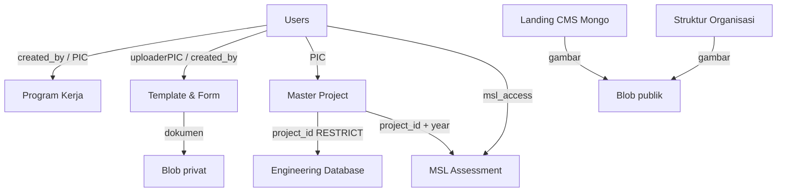

# 03 — SYSTEM ARCHITECTURE

## 1. Peta Lapisan

```
┌──────────────────────────────────────────────────────────────────┐
│ Browser                                                          │
│  Landing (client components)   Dashboard (client components)     │
└───────────────┬──────────────────────────┬───────────────────────┘
                │ fetch /api/*/public      │ fetch /api/* (cookie)
┌───────────────▼──────────────────────────▼───────────────────────┐
│ Next.js App Router (server)                                      │
│  layout.tsx / page.tsx  → guard sesi + perakitan halaman          │
│  route.ts               → auth, permission, Zod, HTTP mapping    │
│  service.ts             → aturan bisnis + assert* (lapis kedua)   │
│  repository.ts          → query Drizzle / driver Mongo            │
└───────────┬──────────────────────────────┬───────────────────────┘
            │                              │
   ┌────────▼────────┐            ┌────────▼─────────┐
   │ PostgreSQL      │            │ MongoDB          │
   │ 13 tabel        │            │ 5 koleksi CMS    │
   └─────────────────┘            └──────────────────┘
            │
   ┌────────▼─────────────────────────────────────────┐
   │ Vercel Blob: store publik (gambar CMS) + privat   │
   └──────────────────────────────────────────────────┘
```

## 2. Rendering Strategy

| Permukaan | Jenis | Alasan (dari kode) |
|---|---|---|
| `src/app/page.tsx` | Server Component | merangkai section; tidak menyimpan state |
| Section landing (`Hero`, `Projects`, `GreenBuilding`, `SocialMedia`, `Clients`) | **Client** (`"use client"`) | memuat data CMS via `fetch` di `useEffect`, punya state loading/empty |
| `Navbar` | **Client** (`"use client"`) | state `menuOpen` untuk drawer mobile; CTA Portal membuka tab baru |
| `About`, `Footer` | Server (tanpa state) | konten statis; footer memuat tautan placeholder |
| `ProjectDetailModal` | Client | perlu Escape listener, focus, body scroll lock |
| `dashboard/layout.tsx` | **Server** | `requireUser()` + redirect + kirim `{name, role, mslAccess}` ke shell |
| `dashboard/*/layout.tsx` (**19 file**) + `dashboard/layout.tsx` (shell) | Server | guard per modul (`canView*` → redirect `/dashboard`) |
| Page wrapper yang butuh flag (MSL, Struktur Organisasi, Engineering DB) | Server | menghitung `canManage` di server agar browser tidak memutuskan kontrol Admin |
| Halaman modul (`MslEngineeringPage`, `ProgramKerjaTable`, dsb) | Client | form, tabel, chart, modal |

Pola konsisten: **keputusan otorisasi tidak pernah diambil di browser**. Browser hanya menerima flag hasil hitungan server.

## 3. Frontend

- **State**: `useState`/`useEffect`/`useMemo`/`useCallback` lokal. Tidak ada store global, tidak ada React Query/SWR.
- **Fetch**: `fetch()` polos dengan `cache: "no-store"` pada data dashboard; landing memakai pola *empty-first* (render kosong → isi dari API; gagal → empty state, tanpa konten karangan).
- **Form**: controlled component, submit manual, error inline; validasi ringan di klien, Zod di server.
- **Komponen bersama**: `DashboardShell`, `DashboardHeader`, `DashboardSidebar` (649 baris, navigasi digerakkan permission), `lib/cms/use-cms-image-field.ts` (hook upload gambar).
- **Aksesibilitas**: `aria-label` pada kontrol ikon, `role="dialog"` + `aria-modal` + Escape + focus return pada modal, `role="progressbar"` + `aria-valuenow` pada progress, focus ring `outline-secondary`.
- **Responsif**: breakpoint `sm`/`md`/`lg`; sidebar menjadi drawer di mobile.

## 4. Backend

### Pola wajib
```
route.ts  → getActor/getPermittedActor (sesi) → parse (Zod) → service → repository → DB
          → mapDomainError (403/404/409/400/503/502) → NextResponse.json({ data | error })
```

### Pengecualian yang terdokumentasi
| Lokasi | Pengecualian | Alasan di kode |
|---|---|---|
| `/api/auth/login` | tidak memakai `getPermittedActor` | belum ada sesi; memakai throttle + verifikasi bcrypt |
| `/api/auth/logout` | menghapus sesi dari cookie | aksi idempoten |
| `/api/auth/me` | self-service, bukan `USER_MANAGE` | setiap user aktif boleh mengubah field aman miliknya |
| `/api/*/public` | tanpa auth | konsumsi landing |
| `/api/cms/upload`, `/api/template-form/upload` | otorisasi lewat modul + token Blob | dipisah dari CRUD |

### Helper per domain API

Setiap domain enterprise memiliki `src/app/api/<domain>/_helpers.ts` — **5 file** (`engineering-database`, `master-project`, `msl`, `program-kerja`, `template-form`) berisi `getActor()` (sesi → actor, 401 bila gagal), `mapDomainError()` (NotFound 404, Forbidden 403, Conflict 409, Validation 400, Blob 502/503), `parseJsonBody()`, dan `isUuid()`. Modul CMS memakai helper dari `lib/cms/error-response.ts` dengan pola setara. **Menambah domain API baru berarti menambah `_helpers.ts` baru**, bukan mengimpor dari domain lain.

### Konvensi respons
| Kondisi | Status | Body |
|---|---|---|
| sukses baca/tulis | 200 / 201 | `{ data: ... }` |
| validasi Zod | 400 | `{ error: { message, details? } }` |
| tidak login | 401 | `{ error: { message: "Unauthenticated" } }` |
| tidak berhak | 403 | `{ error: { message } }` |
| tidak ditemukan | 404 | idem |
| konflik (unik/FK) | 409 | idem |
| storage tidak dikonfigurasi | 503 | idem |
| storage gagal | 502 | idem |
| login terkunci | 429 + `Retry-After` | idem |

### Transaksi
`db.transaction()` dipakai di `src/lib/program-kerja/service.ts` untuk membuat/mengubah program beserta 12 baris bulanan + PIC. Modul lain memakai operasi tunggal atau urutan tulis yang idempoten.

## 5. Analogy Laravel (penjelas saja)

| WIBEX | Padanan Laravel |
|---|---|
| `app/api/**/route.ts` | Controller |
| `lib/<domain>/service.ts` | Service/Action |
| `lib/<domain>/repository.ts` | Repository |
| `lib/<domain>/schema.ts` (Zod) | FormRequest |
| `dashboard/*/layout.tsx` guard | Middleware/route authorization |
| `lib/auth/permissions.ts` | Gate/Policy (feature-level) |
| `lib/<domain>/access.ts` | Policy (record-level) |
| `drizzle/*.sql` | Migration |

Perbedaan penting: tidak ada Eloquent/ORM global; repository menulis query eksplisit, dan konversi `numeric` → `number` hanya terjadi di repository.

## 6. Dependency Antar Modul



Ketergantungan di atas **diverifikasi** dari foreign key dan pemakaian kode; tidak ada dependensi lain yang diasumsikan.

## 7. Boundary & Risiko Arsitektural

| Aspek | Penilaian | Bukti |
|---|---|---|
| Konsistensi pola | **Baik** — seluruh modul enterprise mengikuti Route→Service→Repository | 49 file route (83 method handler), 12 service (7 `service.ts` + 5 `*.service.ts`) |
| Pemisahan concerns | **Baik** — repository tanpa aturan bisnis; service tanpa HTTP | komentar & isi file |
| Duplikasi | **Sedang** — 5 modul CMS mengulang pola table/form/preview | `components/dashboard/{hero,projects,green-buildings,...}` |
| Ukuran berkas | **Risiko** — 5 file > 700 baris | lihat dokumen 10 |
| Guard halaman | **Tersebar** di 19 layout modul + 1 layout shell | risiko lupa saat menambah modul |
| Tipe lintas batas | Kuat: Zod → service type → DTO `*Public` | `lib/*/schema.ts` |
