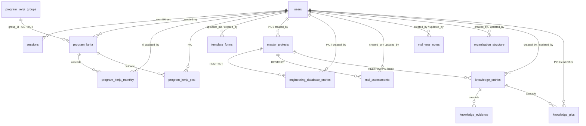

# 04 — DATABASE SCHEMA

Sumber: `src/lib/pg/schema.ts` + `drizzle/0000…0013` + repository Mongo. Kondisi database produksi **BELUM DIKETAHUI** (tidak ada koneksi DB dibuka saat audit).

## 1. ERD PostgreSQL

## 2. Tabel PostgreSQL

### 2.1 `users`
| Kolom | Tipe | Null | Default | Catatan |
|---|---|---|---|---|
| id | uuid | no | `gen_random_uuid()` | PK |
| name | text | no | — | |
| email | text | no | — | **UNIQUE** |
| password_hash | text | no | — | bcrypt cost 12 |
| phone | text | yes | — | |
| nip | text | yes | — | **UNIQUE**; kredensial login |
| position | text | no | — | jabatan |
| photo_url | text | yes | — | |
| role | text | no | `'Project'` | CHECK ∈ Admin, Head Office, Project, Management |
| status | text | no | `'active'` | CHECK ∈ active, suspended |
| msl_access | boolean | no | `false` | capability khusus Management |
| created_at / updated_at | timestamptz | no | now() | |

### 2.2 `sessions`
| Kolom | Tipe | Null | Catatan |
|---|---|---|---|
| id | uuid | no | PK |
| token_hash | text | no | **UNIQUE** — SHA-256 token (token mentah tidak disimpan) |
| user_id | uuid | no | FK `users` **ON DELETE CASCADE** |
| expires_at | timestamptz | no | 24 jam / 30 hari |
| created_at | timestamptz | no | |

Index: `sessions_user_id_idx`, `sessions_expires_at_idx`.

### 2.3 `login_attempts`
| Kolom | Tipe | Null | Catatan |
|---|---|---|---|
| id | uuid | no | PK |
| identity_hash | text | no | SHA-256(`nip.trim()`) — NIP mentah tidak disimpan |
| succeeded | boolean | no | |
| created_at | timestamptz | no | |

Index: `(identity_hash, succeeded, created_at)` + `(created_at)`. Append-only (tidak pernah UPDATE/DELETE oleh kode).

### 2.4 `program_kerja_groups`
`id uuid PK` · `name text UNIQUE NOT NULL` · `sort_order integer` · timestamps.

### 2.5 `program_kerja`
| Kolom | Tipe | Null | Constraint |
|---|---|---|---|
| id | uuid | no | PK |
| group_id | uuid | no | FK groups **RESTRICT** |
| year | integer | no | CHECK `>= 2000` (immutable di service) |
| name / description | text | no | |
| start_month / end_month | integer | no | CHECK 1–12 dan `start <= end` |
| parameter | text | no | indikator |
| unit | text | no | CHECK ∈ `Jumlah`, `Persentase` |
| monitor / note / evidence_url | text | yes | |
| created_by | uuid | no | FK users **NO ACTION** |
| timestamps | | | |

Index: `group_id`, `year`, `created_by`.

**Tidak ada UNIQUE domain** (mis. `group_id + year + name`). Duplikasi nama program dalam satu grup/tahun karena itu tidak dicegah database maupun service (service hanya melempar konflik untuk aturan PIC/unit/periode). Apakah ini disengaja **PERLU VERIFIKASI** — lihat GAP-13 di `23-SECOND-PASS-GAP-REGISTER.md`.

### 2.6 `program_kerja_monthly`
| Kolom | Tipe | Null | Constraint |
|---|---|---|---|
| id | uuid | no | PK |
| program_kerja_id | uuid | no | FK **CASCADE** |
| month | integer | no | CHECK 1–12 |
| ra_value | numeric | no | CHECK `>= 0` |
| ri_value | numeric | **yes** | `NULL` = belum dilaporkan, `0` = nol; CHECK NULL atau `>= 0` |
| ri_updated_by | uuid | yes | FK users **SET NULL** |
| ri_updated_at | timestamptz | yes | |
| timestamps | | | |

**UNIQUE (program_kerja_id, month)** — juga berfungsi sebagai index lookup 12 baris.

### 2.7 `program_kerja_pics`
`program_kerja_id` + `user_id` sebagai **PK komposit**; FK program CASCADE, FK user **NO ACTION**; `assigned_at`.

### 2.8 `template_forms`
| Kolom | Tipe | Null | Constraint |
|---|---|---|---|
| id | uuid | no | PK |
| name | text | no | |
| source_type | text | no | CHECK ∈ `link`, `upload` |
| file_url | text | yes | hanya untuk `link` |
| file_name / file_mime_type | text | yes | hanya untuk `upload` |
| file_size_bytes | bigint | yes | CHECK NULL atau `> 0` |
| blob_pathname | text | yes | identitas storage; **tidak pernah dikirim ke klien** |
| uploader_pic_user_id | uuid | no | FK users **NO ACTION**; wajib role Head Office (service) |
| created_by | uuid | no | FK users **NO ACTION** |

CHECK `template_forms_source_integrity_check`: kombinasi `link` (file_url ada, blob null) **atau** `upload` (file_url null, blob + file_name ada). **UNIQUE parsial** `blob_pathname` (WHERE NOT NULL) — satu objek tidak boleh diklaim dua record.

### 2.9 `master_projects`
| Kolom | Tipe | Null | Constraint |
|---|---|---|---|
| id | uuid | no | PK |
| name / location | text | no | |
| year | integer | no | CHECK `>= 2000`; **satu-satunya sumber tahun untuk MSL** |
| pic_user_id / created_by | uuid | no | FK users **NO ACTION** |

**UNIQUE** `lower(btrim(name))`, `lower(btrim(location))` — duplikat case/spasi ditolak. Index GIN trigram pada `name` dan `location` (butuh `pg_trgm`, dibuat di migration 0004). Index `year`, `pic_user_id`, `created_by`.

Bentuk `(name, location)` **tidak menyertakan year** — proyek sama di tahun berbeda tetap dianggap duplikat.

### 2.10 `engineering_database_entries`
| Kolom | Tipe | Null | Constraint |
|---|---|---|---|
| id | uuid | no | PK |
| project_id | uuid | no | FK `master_projects` **RESTRICT** |
| category | text | no | CHECK ∈ 6 kategori |
| file_url | text | no | tautan dokumen eksternal |
| pic_user_id / created_by | uuid | no | FK users **NO ACTION** |
| note | text | no | |

Index `(category, project_id)`, `project_id`, `pic_user_id`, `created_by`. **Tidak ada UNIQUE** pada (project, category): satu proyek boleh punya banyak dokumen per kategori.

Kategori: `ENGINEERING_DRAWING`, `ENGINEERING_DESIGN_REPORT`, `METODE_PELAKSANAAN_PEKERJAAN`, `SPESIFIKASI_TEKNIS`, `PROJECT_MASTER_SCHEDULE`, `BIM`.

### 2.11 `msl_assessments`
| Kolom | Tipe | Null | Constraint |
|---|---|---|---|
| id | uuid | no | PK |
| project_id | uuid | no | FK **RESTRICT** (hapus Master Project → 409) |
| assessment_month | integer | no | CHECK 1–12; **immutable** (pindah bulan = hapus + buat) |
| engineering_value | numeric(3,2) | no | CHECK 0–5 |
| metode_kerja | numeric(3,2) | no | CHECK 0–5 |
| engineering_execution | numeric(3,2) | no | CHECK 0–5 |
| remarks | text | yes | |
| created_by / updated_by | uuid | no | FK users **NO ACTION** |

**UNIQUE (project_id, assessment_month)**. `score` dan `category` **tidak disimpan** (diturunkan di `lib/msl/score.ts`).

### 2.12 `msl_year_notes`
`year integer` **UNIQUE** + CHECK `>= 2000`; `note text NULL` (NULL = belum pernah ditulis); `created_by/updated_by` + timestamps. Satu catatan per tahun, tidak per proyek.

### 2.13 `organization_structure`
| Kolom | Tipe | Null | Constraint |
|---|---|---|---|
| id | uuid | no | PK |
| singleton | boolean | no | default `true`; **CHECK (singleton)** + **UNIQUE** → maksimal satu baris |
| image_url | text | no | CHECK panjang > 0 |
| blob_pathname | text | no | CHECK panjang > 0 |
| file_name | text | yes | diturunkan server |
| created_by | uuid | no | FK users **NO ACTION** |
| updated_by | uuid | yes | FK users **SET NULL** |

"Belum ada chart" = tidak ada baris. Tidak ada kolom versi/histori.

## 3. Ekstensi & Kebijakan Semantik

| Item | Nilai |
|---|---|
| Ekstensi | `pg_trgm` (migration 0004) |
| Konversi angka | `numeric` → `number` **hanya** di repository MSL; di atasnya selalu `number` |
| Waktu | `timestamptz`; tampilan memakai zona Asia/Jakarta |
| Hapus user | Ditolak (FK NO ACTION) bila masih menjadi `created_by`/PIC; sesi dihapus saat suspend |
| Hapus program | Baris bulanan + PIC ikut terhapus (CASCADE) |
| Hapus Master Project | Ditolak bila masih dipakai Engineering DB atau MSL (RESTRICT) |

## 4. MongoDB

Koneksi: `src/lib/db/mongodb.ts`, client di-cache di `globalThis`, nama DB dari `MONGODB_DB_NAME`.

| Koleksi | Sumber kode | Field dokumen | Field publik (projection) | Filter publik | Index |
|---|---|---|---|---|---|
| `heroes` | `hero.repository.ts` | title, projectName, location, imageUrl, imageAlt, description, status(`active`/`standby`), sortOrder, imageSource?, blobPathname?, timestamps | imageUrl, imageAlt, projectName, location, title | `status:"active"` | `{status:1, sortOrder:1}` |
| `portfolio_projects` | `portfolio-project.repository.ts` | title, category, location, progress, status(`Active`/`Draft`), imageUrl, imageAlt, description, sortOrder, imageSource?, blobPathname?, timestamps | title, category, location, progress, imageUrl, imageAlt, description | `status:"Active"` | `{status:1, sortOrder:1}` |
| `green_building_certificates` | `green-building.repository.ts` | projectName, certificationBody, certificationType, level, year, certificateNumber, score, description, imageUrl, imageAlt, status(`Verified`/`Pending`/`Expired`), publishStatus(`Draft`/`Published`/`Archived`), sortOrder, imageSource?, blobPathname? | projectName, certificationBody, imageUrl, imageAlt, level, year, score, description | `publishStatus:"Published"` | `{publishStatus:1, sortOrder:1}` |
| `social_posts` | `social-post.repository.ts` | platform(`instagram`), account, caption, url, type, imageUrl, imageAlt, status(`Published`/`Draft`/`Hidden`), sortOrder, imageSource?, blobPathname? | platform, account, caption, url, type, imageUrl | `status:"Published"` | `{status:1, sortOrder:1}` |
| `clients` | `client.repository.ts` | name, shortName, category, link, logoUrl, logoAlt, status(`active`/`hidden`), sortOrder, imageSource?, blobPathname? | name, shortName, logoUrl, logoAlt, link | `status:"active"` | `{status:1, sortOrder:1}` |

Catatan validitas:
- **Tidak ada skema MongoDB yang ditegakkan** (tidak ada `$jsonSchema`/validator). Bentuk dokumen adalah konvensi kode + validasi Zod, bukan jaminan database. Status: **INFERRED dari kode**.
- Indeks dibuat **lazy** (`let indexesEnsured = false` lalu `createIndex` pada request pertama), bukan migration.
- `clients` menyimpan `category` di dokumen, tetapi **tidak** ada di projection publik (tidak dipakai landing).
- `social_posts` tidak mengirim `imageAlt` ke publik (landing memakai glyph fallback bila `imageUrl` kosong).

## 5. Skema vs Migration

- 15 migration bernama acak (drizzle-kit) tetapi berurutan; drizzle-kit menulis snapshot di `drizzle/meta/`.
- Tidak ada migration yang menghapus tabel; semuanya aditif/ALTER, konsisten dengan riwayat fitur.
- **Drift produksi BELUM DIKETAHUI** — tidak ada `SELECT` yang dijalankan.
- Jika menambah kolom: buat file migration **baru**, jangan edit yang lama, dan perbarui `schema.ts` pada perubahan yang sama.

## 6. Knowledge Management V1 (migrasi `0013`, 4 November 2026)

Satu tabel bersama untuk tiga submenu, bukan tiga tabel identik: kolomnya sama, pembedanya hanya `knowledge_type`.

### 6.1 `knowledge_entries`
| Kolom | Tipe | Null | Default | Catatan |
|---|---|---|---|---|
| id | uuid | no | `gen_random_uuid()` | PK |
| project_id | uuid | no | — | FK → `master_projects.id`, **ON DELETE RESTRICT** |
| knowledge_type | text | no | — | CHECK ∈ `lesson_learn`, `best_practice`, `va_ve` |
| content | text | no | — | teks multiline apa adanya; CHECK `length(btrim) > 0` |
| created_by / updated_by | uuid | no / yes | — | FK → `users.id` (NO ACTION / SET NULL) |
| created_at / updated_at | timestamptz | no | now() | |

Constraint kunci: **`UNIQUE(project_id, knowledge_type)`** — "paling banyak satu data per proyek per submenu" ditegakkan database, bukan hanya service. Index: `knowledge_type`, `created_by`.

### 6.2 `knowledge_evidence`
| Kolom | Tipe | Catatan |
|---|---|---|
| id | uuid PK | |
| knowledge_entry_id | uuid | FK → `knowledge_entries.id`, cascade |
| name | text | CHECK `length(btrim) > 0` |
| url | text | CHECK regex `^https?://` (lapis kedua setelah Zod) |
| sort_order | integer | urutan tampilan |
| created_at | timestamptz | |

### 6.3 `knowledge_pics`
PK komposit `(knowledge_entry_id, user_id)`; entry cascade, user NO ACTION (assignment tidak hilang diam-diam). Tidak ada CHECK role: kelayakan Head Office adalah aturan service. Sejak `0014`, jumlah PIC per entry dijaga minimal satu oleh constraint trigger deferred (lihat bagian 7).

### 6.4 Keputusan penghapusan
`project_id` memakai **RESTRICT**: Master Project yang sudah memiliki knowledge tidak dapat di-hard-delete, sehingga isi knowledge tidak hilang tanpa disadari. Master Project sudah memetakan `23503`/`23001` menjadi **409**, jadi perilakunya terdefinisi (bukan 500).

### 6.5 Catatan snapshot Drizzle
Rantai snapshot `drizzle/meta/` tidak memiliki `0011`/`0012` (kedua migration itu ditulis manual). Akibatnya `drizzle-kit generate` ikut mengeluarkan ulang objek `organization_structure` dan kolom MSL. Statement tersebut **dihapus** dari `0013`; migration hanya berisi objek Knowledge Management. Snapshot `0013` tetap menggambarkan skema penuh, sehingga `generate` berikutnya tidak mengulang drift.

## 7. Knowledge PIC minimum (migrasi `0014`, 4 November 2026)

Aturan bisnis baru: setiap record Knowledge Management wajib memiliki **minimal satu PIC** ber-role Head Office. CHECK biasa tidak dapat menegakkan invariant lintas tabel, sehingga migration aditif ini menambahkan dua constraint trigger `DEFERRABLE INITIALLY DEFERRED`:

- `knowledge_entries_require_pic_trigger` — `AFTER INSERT OR UPDATE` pada `knowledge_entries`, gagal `23514` bila entry tidak punya baris `knowledge_pics`. Deferred karena service menulis entry dan PIC dalam satu transaksi (PIC di-`DELETE` lalu di-`INSERT`); pemeriksaan harus melihat keadaan akhir saat COMMIT.
- `knowledge_pics_require_remaining_trigger` — `AFTER DELETE` pada `knowledge_pics`, mencegah PIC terakhir dihapus; dilewati bila parent entry ikut terhapus (cascade).

Konsekuensi: Zod dan service sudah menolak lebih awal (400), sedangkan trigger menjadi jaring pengaman untuk penulisan SQL langsung. Service memetakan `23514` menjadi **400** "Minimal 1 PIC".

Catatan snapshot: trigger tidak direpresentasikan di `drizzle/schema.ts`, jadi `0014` ditulis manual dan tidak memiliki snapshot baru; `npx drizzle-kit check` tetap PASS. **Status eksekusi (4 November 2026): APPLIED** pada database `neondb` (Neon, PostgreSQL 18.6) setelah owner mengesahkan target. Audit riwayat menunjukkan 13 migrasi historis `0000`–`0012` sudah teraplikasi dengan hash yang cocok, tanpa objek Knowledge Management, sehingga hanya `0013` dan `0014` yang dijalankan. Verifikasi objek dan perilaku constraint: 23/23 PASS (tabel, 11 constraint, 2 trigger deferred, penolakan PIC kosong/penghapusan PIC terakhir, CHECK content/URL, UNIQUE, duplikasi) di dalam transaksi yang di-rollback — 0 baris data tertinggal. Rincian di `docs/development/DEVELOPMENT_MASTER_LOG.md` (DL-2026-11-04-05).
