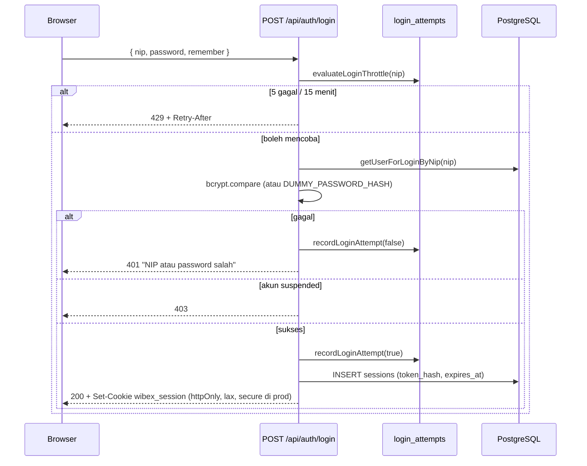

# 06 — AUTHENTICATION AND AUTHORIZATION

## 1. Siklus Autentikasi

| Aspek | Implementasi | Bukti |
|---|---|---|
| Kredensial | NIP + password | `loginSchema`, `users.nip` |
| Hash password | bcrypt cost **12** | `src/lib/auth/password.ts` |
| Anti-enumerasi | hash dummy konstan bila NIP tidak ada (satu bcrypt selalu dijalankan) | `DUMMY_PASSWORD_HASH` |
| Token sesi | 32 byte acak hex; DB menyimpan SHA-256 | `src/lib/auth/session.ts` |
| Cookie | `wibex_session`, httpOnly, `sameSite=lax`, `secure` di produksi, path `/` | route login/logout |
| Durasi | 24 jam; 30 hari bila "Ingat Sesi Kerja" | `SESSION_DURATION_SECONDS` / `REMEMBER_...` |
| Sesi kedaluwarsa | dihapus saat ditemukan (`findSessionByToken`) | `deleteSessionById` |
| Logout | hapus baris + cookie `maxAge: 0` | `/api/auth/logout` |
| Suspensi | `getCurrentUser()` menolak user non-`active`; sesi dicabut saat suspend | `current-user.ts`, `users/service.ts` |
| Lockout | 5 kegagalan / 15 menit per hash NIP; state diturunkan dari baris (tanpa flag) | `login-attempts.ts` |
| Retensi | `deleteExpiredSessions` ada, **tidak ada penjadwalan** | — |

## 2. Tiga Lapis Otorisasi

| Lapis | Lokasi | Perilaku |
|---|---|---|
| 1. Layout server | `src/app/dashboard/**/layout.tsx` (**19 layout modul + 1 shell**) | `getCurrentUser()` → redirect `/login`; `canView*` → redirect `/dashboard` |
| 2. Route handler | `src/app/api/**/route.ts` | `getPermittedActor` / `getActor` / `apiAuthGuard` → 401/403 |
| 3. Service | `src/lib/*/service.ts` | `assertCanManageCms`, `assertManageAccess`, `assertCanManageUsers`, dst → error domain → 403 |

Tidak ada `middleware.ts`. Ini aman selama setiap route memeriksa sesi sendiri — kondisi itu **terverifikasi** untuk seluruh route non-publik.

## 3. Matriks Permission (sumber: `src/lib/auth/permissions.ts`)

| Permission | Admin | Head Office | Management | Project | Penegak |
|---|---|---|---|---|---|
| `CMS_MANAGE` | ✔ (super) | ✗ | ✗ | ✗ | `lib/cms/access.ts` |
| `USER_MANAGE` | ✔ | ✗ | ✗ | ✗ | `lib/users/access.ts` |
| `PROGRAM_KERJA_VIEW` | ✔ | ✔ | ✔ | ✗ | `lib/program-kerja/access.ts` |
| `PROGRAM_KERJA_MANAGE` | ✔ | ✔ | ✗ | ✗ | idem |
| `PROGRAM_KERJA_EDIT_RI` | ✔ | ✔ **+ wajib PIC** | ✗ | ✗ | `canUpdateProgramRi` |
| `TEMPLATE_FORM_VIEW` | ✔ | ✔ | ✔ | ✔ | `lib/template-form/access.ts` |
| `TEMPLATE_FORM_MANAGE` | ✔ | ✔ | ✗ | ✗ | idem |
| `MASTER_PROJECT_VIEW` | ✔ | ✔ | ✔ | ✔ | `lib/master-project/access.ts` |
| `MASTER_PROJECT_CREATE` | ✔ | ✔ | ✗ | ✗ | idem |
| `MASTER_PROJECT_EDIT` | ✔ | ✔ | ✗ | ✔ | idem |
| `MASTER_PROJECT_DELETE` | ✔ | ✔ | ✗ | ✗ | idem |
| `ENGINEERING_DATABASE_VIEW` | ✔ | ✔ | ✔ | ✔ | `lib/engineering-database/access.ts` |
| `ENGINEERING_DATABASE_MANAGE` | ✔ | ✔ | ✗ | ✔ | idem |
| `MSL_VIEW` | ✔ | ✔ | hanya `msl_access` | ✗ | `lib/msl/access.ts` |
| `MSL_MANAGE` | ✔ | ✗ | hanya `msl_access` | ✗ | idem |
| `ORGANIZATION_STRUCTURE_VIEW` | ✔ | ✔ | ✔ | ✔ | `lib/organization-structure/access.ts` |
| `ORGANIZATION_STRUCTURE_MANAGE` | ✔ | ✗ | ✗ | ✗ | idem |
| `DASHBOARD_SASAA_VIEW` | ✔ | ✔ | ✔ | ✗ | **belum dipakai route mana pun** |

`hasPermission(role, permission)` mengembalikan `true` untuk Admin pada semua permission fitur (`isAdmin`), lalu mencocokkan role pada daftar non-Admin. Role tak dikenal → `false`.

## 4. Aturan Record-Level

| Aturan | Bukti |
|---|---|
| RI Program Kerja: Admin selalu; Head Office harus PIC | `canUpdateProgramRi(role, isAssignedPic)` |
| PIC Program Kerja & PIC Template & Form harus **Head Office** | `validateUploaderPic`, opsi PIC |
| PIC Master Project: Admin/Head Office | `pic-options` |
| PIC Engineering DB: Admin/Head Office/Project | `isEngineeringDatabasePicRole` |
| Opsi PIC **tidak** memfilter `status` akun (V1, komentar eksplisit) — user suspended masih muncul sebagai opsi | `engineering-database/repository.ts` baris 158–168; pola serupa di `listHeadOfficePicOptions` |
| `msl_access` hanya berlaku untuk Management; role lain dipaksa `false` | `lib/msl/access.ts` + `users/service.ts` |
| Admin terakhir tidak boleh disuspend/dihapus | `CannotSuspendLastAdminError`, `CannotDeleteLastAdminError` |
| User tidak boleh menonaktifkan/menghapus dirinya sendiri | route users PATCH/DELETE |
| Field immutable pada self-profile (role/status/nip/email) | `updateOwnProfile` hanya menulis field aman |

## 5. UI Visibility vs Enforcement

| Area | Disembunyikan di UI | Ditegakkan di server |
|---|---|---|
| Sidebar (8 flag `canView*`/`canManage*`) | ya — `DashboardSidebar` baris 249–259 | ya (route + service) |
| Kontrol Admin di Struktur Organisasi | ya — `canManage` dihitung di page server | ya (`ORGANIZATION_STRUCTURE_MANAGE`) |
| Tombol MSL | ya — `canViewMsl({role, mslAccess})` | ya (`canViewMsl`/`canManageMsl`) |
| Menu CMS & User Directory | ya | ya |

**Tidak ditemukan** elemen UI yang menjadi satu-satunya kontrol akses.

## 6. Risiko & Catatan

| ID | Risiko | Tingkat | Status |
|---|---|---|---|
| A-01 | Tidak ada pemeriksaan `Origin`/`Sec-Fetch-Site` atau token CSRF pada mutasi; mitigasi bersandar pada `sameSite=lax` | LOW | PARTIALLY VERIFIED (desain sadar) |
| A-02 | `deleteExpiredSessions` tidak dijadwalkan → baris kedaluwarsa menumpuk | LOW | VERIFIED |
| A-03 | Login gagal untuk akun suspended menulis attempt? — jalur suspended mengembalikan 403 tanpa `recordLoginAttempt` | INFORMATIONAL | VERIFIED (tidak menulis) |
| A-04 | Sesi tidak dirotasi saat privilege berubah (hanya dicabut saat suspend/ganti password) | LOW | VERIFIED |
| A-05 | `secure` cookie hanya di produksi → pada deployment non-HTTPS cookie terkirim tanpa flag | INFORMATIONAL | VERIFIED |
| A-06 | Tidak ada MFA | INFORMATIONAL | VERIFIED (tidak ada) |
| A-07 | `apiAuthGuard()` diekspor tetapi tidak dipakai route mana pun | INFORMATIONAL | VERIFIED (0 call site) |

Tidak ditemukan jalur eskalasi hak akses: Admin shortcut hanya di level fitur, sedangkan integritas (admin terakhir, FK, field immutable) tetap ditegakkan.
