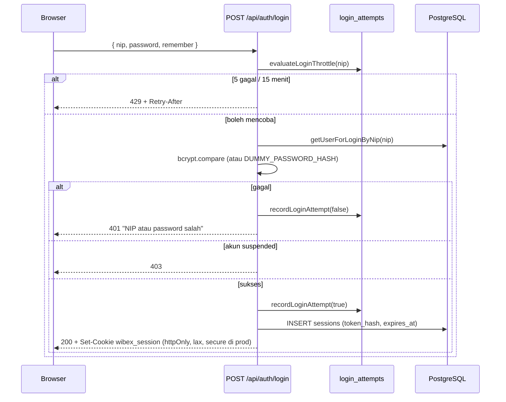

# 06 — AUTHENTICATION AND AUTHORIZATION

## 1. Siklus Autentikasi

| Aspek | Implementasi | Bukti |
|---|---|---|
| Kredensial | NIP + password | `loginSchema`, `users.nip` |
| Hash password | bcrypt cost **12** | `src/lib/auth/password.ts` |
| Anti-enumerasi | hash dummy konstan bila NIP tidak ada (satu bcrypt selalu dijalankan) | `DUMMY_PASSWORD_HASH` |
| Token sesi | 32 byte acak hex; DB menyimpan SHA-256 | `src/lib/auth/session.ts` |
| Cookie | `wibex_session`, httpOnly, `sameSite=lax`, `secure` di produksi, path `/` | route login/logout |
| Durasi | 24 jam; 30 hari bila "Ingat Sesi Kerja" | `SESSION_DURATION_SECONDS` / `REMEMBER_...` |
| Sesi kedaluwarsa | dihapus saat ditemukan (`findSessionByToken`) | `deleteSessionById` |
| Logout | hapus baris + cookie `maxAge: 0` | `/api/auth/logout` |
| Suspensi | `getCurrentUser()` menolak user non-`active`; sesi dicabut saat suspend | `current-user.ts`, `users/service.ts` |
| Lockout | 5 kegagalan / 15 menit per hash NIP; state diturunkan dari baris (tanpa flag) | `login-attempts.ts` |
| Retensi | `deleteExpiredSessions` ada, **tidak ada penjadwalan** | — |

## 2. Tiga Lapis Otorisasi

| Lapis | Lokasi | Perilaku |
|---|---|---|
| 1. Layout server | `src/app/dashboard/**/layout.tsx` (**23 layout modul + 1 shell**) | `getCurrentUser()` → redirect `/login`; `canView*` → redirect `/dashboard` |
| 2. Route handler | `src/app/api/**/route.ts` | `getPermittedActor` / `getActor` / `apiAuthGuard` → 401/403 |
| 3. Service | `src/lib/*/service.ts` | `assertCanManageCms`, `assertManageAccess`, `assertCanManageUsers`, dst → error domain → 403 |

Tidak ada `middleware.ts`. Ini aman selama setiap route memeriksa sesi sendiri — kondisi itu **terverifikasi** untuk seluruh route non-publik.

## 3. Matriks Permission (sumber: `src/lib/auth/permissions.ts`)

| Permission | Admin | Head Office | Management | Project | Penegak |
|---|---|---|---|---|---|
| `CMS_MANAGE` | ✔ (super) | ✗ | ✗ | ✗ | `lib/cms/access.ts` |
| `USER_MANAGE` | ✔ | ✗ | ✗ | ✗ | `lib/users/access.ts` |
| `PROGRAM_KERJA_VIEW` | ✔ | ✔ | ✔ | ✗ | `lib/program-kerja/access.ts` |
| `PROGRAM_KERJA_MANAGE` | ✔ | ✔ | ✗ | ✗ | idem |
| `PROGRAM_KERJA_EDIT_RI` | ✔ | ✔ **+ wajib PIC** | ✗ | ✗ | `canUpdateProgramRi` |
| `TEMPLATE_FORM_VIEW` | ✔ | ✔ | ✔ | ✔ | `lib/template-form/access.ts` |
| `TEMPLATE_FORM_MANAGE` | ✔ | ✔ | ✗ | ✗ | idem |
| `MASTER_PROJECT_VIEW` | ✔ | ✔ | ✔ | ✔ | `lib/master-project/access.ts` |
| `MASTER_PROJECT_CREATE` | ✔ | ✔ | ✗ | ✗ | idem |
| `MASTER_PROJECT_EDIT` | ✔ | ✔ | ✗ | ✔ | idem |
| `MASTER_PROJECT_DELETE` | ✔ | ✔ | ✗ | ✗ | idem |
| `ENGINEERING_DATABASE_VIEW` | ✔ | ✔ | ✔ | ✔ | `lib/engineering-database/access.ts` |
| `ENGINEERING_DATABASE_MANAGE` | ✔ | ✔ | ✗ | ✔ | idem |
| `MSL_VIEW` | ✔ | ✔ | hanya `msl_access` | ✗ | `lib/msl/access.ts` |
| `MSL_MANAGE` | ✔ | ✗ | hanya `msl_access` | ✗ | idem |
| `ORGANIZATION_STRUCTURE_VIEW` | ✔ | ✔ | ✔ | ✔ | `lib/organization-structure/access.ts` |
| `ORGANIZATION_STRUCTURE_MANAGE` | ✔ | ✗ | ✗ | ✗ | idem |
| `CALCULATION_SHEET_VIEW` | ✔ | ✔ | ✔ | ✔ | `lib/calculation-sheet-template/service.ts` (`assertViewAccess`) |
| `CALCULATION_SHEET_MANAGE` | ✔ | ✔ | ✗ | ✗ | idem (`assertManageAccess`) |
| `DOCUMENTATION_VIEW` | ✔ | ✔ | ✔ | ✔ | `lib/project-documentation/service.ts` (`assertViewAccess`) |
| `DOCUMENTATION_MANAGE` | ✔ | ✔ | ✗ | ✔ | idem (`assertManageAccess`) |
| `DASHBOARD_SASAA_VIEW` | ✔ | ✔ | ✔ | ✗ | **belum dipakai route mana pun** |

`hasPermission(role, permission)` mengembalikan `true` untuk Admin pada semua permission fitur (`isAdmin`), lalu mencocokkan role pada daftar non-Admin. Role tak dikenal → `false`.

## 4. Aturan Record-Level

| Aturan | Bukti |
|---|---|
| RI Program Kerja: Admin selalu; Head Office harus PIC | `canUpdateProgramRi(role, isAssignedPic)` |
| PIC Program Kerja & PIC Template & Form harus **Head Office** | `validateUploaderPic`, opsi PIC |
| PIC Master Project: Admin/Head Office | `pic-options` |
| PIC Engineering DB: Admin/Head Office/Project | `isEngineeringDatabasePicRole` |
| Opsi PIC **tidak** memfilter `status` akun (V1, komentar eksplisit) — user suspended masih muncul sebagai opsi | `engineering-database/repository.ts` baris 158–168; pola serupa di `listHeadOfficePicOptions` |
| `msl_access` hanya berlaku untuk Management; role lain dipaksa `false` | `lib/msl/access.ts` + `users/service.ts` |
| Admin terakhir tidak boleh disuspend/dihapus | `CannotSuspendLastAdminError`, `CannotDeleteLastAdminError` |
| User tidak boleh menonaktifkan/menghapus dirinya sendiri | route users PATCH/DELETE |
| Field immutable pada self-profile (role/status/nip/email) | `updateOwnProfile` hanya menulis field aman |

## 5. UI Visibility vs Enforcement

| Area | Disembunyikan di UI | Ditegakkan di server |
|---|---|---|
| Sidebar (8 flag `canView*`/`canManage*`) | ya — `DashboardSidebar` baris 249–259 | ya (route + service) |
| Kontrol Admin di Struktur Organisasi | ya — `canManage` dihitung di page server | ya (`ORGANIZATION_STRUCTURE_MANAGE`) |
| Tombol MSL | ya — `canViewMsl({role, mslAccess})` | ya (`canViewMsl`/`canManageMsl`) |
| Menu CMS & User Directory | ya | ya |
| Menu + tombol CST (Edit/Hapus/Tambah) | ya — `hasPermission(role, CALCULATION_SHEET_MANAGE)` dihitung di page server; sidebar memakai `CALCULATION_SHEET_VIEW` | ya (layout guard + `assertManageAccess` di service) |
| Menu + tombol PDOC (Edit/Simpan/Batal) | ya — `canManageDocumentation(role)` dihitung di page server; sidebar memakai `DOCUMENTATION_VIEW`; PDF tetap terlihat untuk semua role View | ya (layout guard + `assertViewAccess`/`assertManageAccess` + `DOCUMENTATION_MANAGE` di route) |

**Tidak ditemukan** elemen UI yang menjadi satu-satunya kontrol akses.

## 6. Risiko & Catatan

| ID | Risiko | Tingkat | Status |
|---|---|---|---|
| A-01 | Tidak ada pemeriksaan `Origin`/`Sec-Fetch-Site` atau token CSRF pada mutasi; mitigasi bersandar pada `sameSite=lax` | LOW | PARTIALLY VERIFIED (desain sadar) |
| A-02 | `deleteExpiredSessions` tidak dijadwalkan → baris kedaluwarsa menumpuk | LOW | VERIFIED |
| A-03 | Login gagal untuk akun suspended menulis attempt? — jalur suspended mengembalikan 403 tanpa `recordLoginAttempt` | INFORMATIONAL | VERIFIED (tidak menulis) |
| A-04 | Sesi tidak dirotasi saat privilege berubah (hanya dicabut saat suspend/ganti password) | LOW | VERIFIED |
| A-05 | `secure` cookie hanya di produksi → pada deployment non-HTTPS cookie terkirim tanpa flag | INFORMATIONAL | VERIFIED |
| A-06 | Tidak ada MFA | INFORMATIONAL | VERIFIED (tidak ada) |
| A-07 | `apiAuthGuard()` diekspor tetapi tidak dipakai route mana pun | INFORMATIONAL | VERIFIED (0 call site) |

Tidak ditemukan jalur eskalasi hak akses: Admin shortcut hanya di level fitur, sedangkan integritas (admin terakhir, FK, field immutable) tetap ditegakkan.

## 7. Knowledge Management V1 (4 November 2026 — SUPERSEDED by V2, lihat §8)

| Permission | Admin | Head Office | Management | Project | Penegak |
|---|---|---|---|---|---|
| `KNOWLEDGE_MANAGEMENT_VIEW` | ✔ (super) | ✔ | ✔ | ✔ | `lib/knowledge-management/access.ts` |
| `KNOWLEDGE_MANAGEMENT_MANAGE` | ✔ | ✔ | ✗ | ✗ | idem + `assertManageAccess` di service |

**Routing & hierarki (diperbarui 4 November 2026).** Halaman berada di namespace sendiri `/dashboard/knowledge-management/*` dengan layout guard `canViewKnowledgeManagement`. Namespace `/dashboard/program-kerja/*` **tidak diubah** dan tetap menolak Project lewat `PROGRAM_KERJA_VIEW`. Sidebar kini menampilkan Knowledge Management sebagai **item top-level sendiri (sibling Program Kerja)** dengan state accordion terpisah, dan otomatis terbuka pada route KM. **Diperbarui 8 November 2026:** nilai awalnya kini route-driven (default collapsed, sama seperti Metode Kerja Standar); role hanya menentukan visibilitas item, bukan ekspansi awal. Project melihat Knowledge Management tanpa melihat Program Kerja; tidak ada tambahan akses Program Kerja. Matriks izin di atas tidak berubah.

**Regresi navigasi (4 November 2026).** 16 unit test khusus sidebar PASS: visibilitas empat role, Project tanpa `PROGRAM_KERJA_VIEW`, penolakan role tanpa izin, independensi dari accordion Program Kerja, default terbuka, auto-open route KM, tiga route submenu, tidak ada duplikasi, dan Program Kerja tetap dua link. **Browser Head Office PASS** untuk navigasi (desktop 1280×800, mobile 390×844, active route, independensi accordion); Admin/Management/Project **NOT RUN** (tanpa sesi/kredensial).

**Tiga lapis tetap berlaku:** layout (`canViewKnowledgeManagement`), route (`getActor` → sesi), service (`assertViewAccess` / `assertManageAccess` → 403). Role dan identitas tidak pernah dibaca dari body.

**Status verifikasi role (4 November 2026).** Admin: **PASS** — login, GET, inline edit, PIC, evidence, dan penolakan tanpa sesi diuji runtime. Head Office, Management, Project: **BLOCKED** — akun aktif tersedia (5 Head Office, 1 Management, 1 Project) tetapi tidak ada kredensial di `.env.local`/secret file maupun handoff browser; tidak ada impersonasi, pembuatan user, atau reset password. Matriks izin di atas tetap berlaku sebagai aturan kode, bukan hasil uji HTTP role tersebut.

**Matriks acceptance (4 November 2026).**

| Role | Autentikasi runtime | GET/visibilitas | Mutasi | PIC options | Bukti |
|---|---|---|---|---|---|
| Admin | **PASS** | **PASS** | **PASS** | **PASS** | Login + API + browser (DL-10) |
| Head Office | **BLOCKED** | **NOT RUN** | **NOT RUN** | **NOT RUN** | Tidak ada handoff/kredensial |
| Management | **BLOCKED** | **NOT RUN** | **NOT RUN** | **NOT RUN** | Tidak ada handoff/kredensial |
| Project | **BLOCKED** | **NOT RUN** | **NOT RUN** | **NOT RUN** | Tidak ada handoff/kredensial |

**Security hygiene** (tidak ada mutasi tak sah, tidak ada sesi uji tersisa, tidak ada user diubah) **PASS**. **RBAC authorization** untuk Head Office/Management/Project **belum terverifikasi runtime**; jangan dibaca sebagai PASS.

**Aturan PIC.** Hanya user `Head Office` yang diterima; status akun tidak difilter (suspended tetap eligible, sesuai keputusan V1). Validasi memakai `findUsersByIds` + cek role di service, bukan CHECK database.

## 8. Knowledge Management V2 (5 November 2026)

Matriks izin tidak berubah dari V1; yang berubah adalah cakupan operasi: V2 menambah **create**, **update**, **permanent delete**, dan **project-options**.

| Permission | Admin | Head Office | Management | Project | Penegak |
|---|---|---|---|---|---|
| `KNOWLEDGE_MANAGEMENT_VIEW` | ✔ (super) | ✔ | ✔ | ✔ | `lib/knowledge-management/access.ts` |
| `KNOWLEDGE_MANAGEMENT_MANAGE` | ✔ | ✔ | ✗ | ✗ | idem + `assertManageAccess` di service |

**Keputusan Owner yang mengikat implementasi V2.**

| Kode | Keputusan | Penegak |
|---|---|---|
| D-01 | Hanya Admin dan Head Office yang boleh memutasi; Management/Project read-only | `assertManageAccess` → 403 |
| D-02 | `project_id` dan `knowledge_type` **immutable** setelah create; PUT strict tanpa `project_id` | Zod strict (400) + trigger `knowledge_entries_immutable_fields_trigger` (23514) |
| D-04 | Optimistic concurrency integer `version`; mismatch → 409; satu transaksi aggregate | `expected_version` + `UPDATE … WHERE version = expected` |

**Tiga lapis tetap berlaku:** layout (`canViewKnowledgeManagement`), route (`getActor` → sesi), service (`assertViewAccess`/`assertManageAccess`). Role dan identitas tidak pernah dibaca dari body.

**Status verifikasi role (5 November 2026).**

| Role | Login runtime | GET | Mutasi | PIC options | Verdict |
|---|---|---|---|---|---|
| Admin | **PASS** | **PASS** | **PASS** (201/200/200) | **PASS** | **PASS** |
| Head Office | — | — | — | — | **BLOCKED** — tidak ada kredensial |
| Management | — | — | — | — | **BLOCKED** — tidak ada kredensial |
| Project | — | — | — | — | **BLOCKED** — tidak ada kredensial |

Tidak ada impersonasi, pembuatan user, suspend, atau reset password. Head Office PIC tetap eligible walau `suspended`; tidak ada user suspended di database saat pengujian (N/A). Detail: `DL-2026-11-05-02`.

## 9. Knowledge Management — Enhancement 2026-11-05

Enhancement P4 tidak mengubah permission, guard, atau matriks §8. Yang berubah hanya rendering kolom Aksi di `KnowledgeTable`:

- Kolom **Aksi** sekarang selalu dirender untuk semua role, termasuk Management/Project (read-only).
- Tombol **Lihat** tersedia bagi pemegang `KNOWLEDGE_MANAGEMENT_VIEW` (semua role) dan hanya membuka modal read-only dari data yang sudah dimuat.
- Tombol **Edit** tetap kondisional pada `KNOWLEDGE_MANAGEMENT_MANAGE` (Admin, Head Office); Create/Delete juga tetap Manage-only di UI dan ditegakkan kembali di service (`403`).
- Tombol PDF tabel mengikuti akses View halaman; PDF per-record hanya dapat dipicu dari modal View. Keduanya client-side dan tidak menambah endpoint.

**Status role.** Admin PASS (**Owner confirmed**); Head Office/Management/Project tetap **BLOCKED** karena kredensial tidak tersedia. Detail: `DL-2026-11-05-03`.

## 10. Calculation Sheet Template (9 November 2026)

| Role | Layout/halaman | GET list | POST/PUT/DELETE | `pic-options` | Verdict |
|---|---|---|---|---|---|
| Admin | ✔ | ✔ | ✔ | ✔ | **PASS** (Owner-confirmed) |
| Head Office | ✔ | ✔ | ✔ (termasuk Delete) | ✔ | **PASS** (Owner-confirmed) |
| Management | ✔ | ✔ | ✗ (403) | ✗ (403) | **PASS** — read-only (Owner-confirmed) |
| Project | ✔ | ✔ | ✗ (403) | ✗ (403) | **PASS** — read-only (Owner-confirmed) |

- **Guard berlapis:** `src/app/dashboard/calculation-sheet-template/layout.tsx` memanggil `getCurrentUser()` lalu `CALCULATION_SHEET_VIEW`; API memanggil `getActor()` lalu `assertViewAccess`/`assertManageAccess` di service. UI menyembunyikan tombol mutasi untuk Management/Project, tetapi server tetap menolak bila dipanggil langsung.
- **Berbeda dari MKS:** Head Office memiliki full CRUD termasuk Delete (satu permission `CALCULATION_SHEET_MANAGE`), bukan pola "HO tanpa Delete".
- **PIC:** hanya user role Head Office (termasuk suspended); status dikembalikan agar UI menandai "(non-aktif)". Management/Project tidak dapat memanggil `pic-options`.
- **Status verifikasi:** static checks PASS (233/233 total; suite CST PASS). Migration `0017` **APPLIED**; runtime visual + RBAC 4 role **PASS** (Owner-confirmed 10 November 2026); seluruh baris tabel di atas PASS. Detail: `DL-2026-11-10-04`.

## 11. Project Documentation V1 + Monthly Delta (10 November 2026)

| Role | Layout/halaman | GET Rekap | GET Summary | PUT periodik | PDF | Verdict |
|---|---|---|---|---|---|---|
| Admin | ✔ | ✔ | ✔ | ✔ | ✔ | **PASS** (Owner-confirmed) |
| Head Office | ✔ | ✔ | ✔ | ✔ | ✔ | **PASS** (Owner-confirmed) |
| Management | ✔ | ✔ | ✔ | ✗ (403) | ✔ | **PASS** — read-only (Owner-confirmed) |
| Project | ✔ | ✔ | ✔ | ✔ (semua project) | ✔ | **PASS** (Owner-confirmed) |

- **Permission:** `DOCUMENTATION_VIEW` untuk Admin, Head Office, Management, Project; `DOCUMENTATION_MANAGE` untuk Admin, Head Office, Project. Management hanya membaca rekap dan Summary; tidak ada `DOCUMENTATION_MANAGE`.
- **Routing:** root `/dashboard/project-documentation` redirect ke `/rekap-bulanan`; Summary Report berada di `/summary` dan read-only untuk semua role View. Sidebar memakai accordion dengan submenu **Rekap Bulanan** dan **Summary Report**.
- **Guard berlapis:** layout `/dashboard/project-documentation` memanggil `getCurrentUser()` lalu cek `DOCUMENTATION_VIEW`; page rekap menghitung `canManageDocumentation` untuk tombol Edit; route memakai `getActor()`; service memanggil `assertViewAccess`/`assertManageAccess`. UI bukan satu-satunya kontrol.
- **Record-level:** tidak ada ownership per project. Project dapat mengubah dokumentasi seluruh Master Project; Management tidak dapat menulis. Identitas aktor audit selalu dari sesi, bukan body.
- **PDF:** semua role View dapat mengekspor tabel rekap; PDF dibentuk client-side dan tidak menambah endpoint. Tombol Edit/Simpan/Batal hanya muncul untuk `DOCUMENTATION_MANAGE`. Summary tidak memiliki aksi tulis.
- **Status verifikasi:** static checks PASS (233/233, 59 suite; 58 test PDOC di 6 file). Commit `a7527e1` sudah di-push. Migration `0018_project_documentations` **APPLIED**; `0019_project_documentation_period` **APPLIED** (Owner-confirmed 10 November 2026). Runtime visual + RBAC 4 role **PASS** (Owner-confirmed 10 November 2026); seluruh baris tabel di atas PASS. Detail: `DL-2026-11-10-03`.
