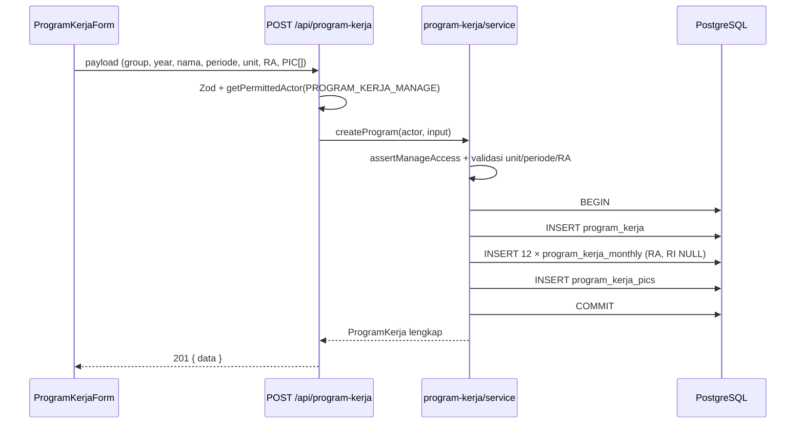
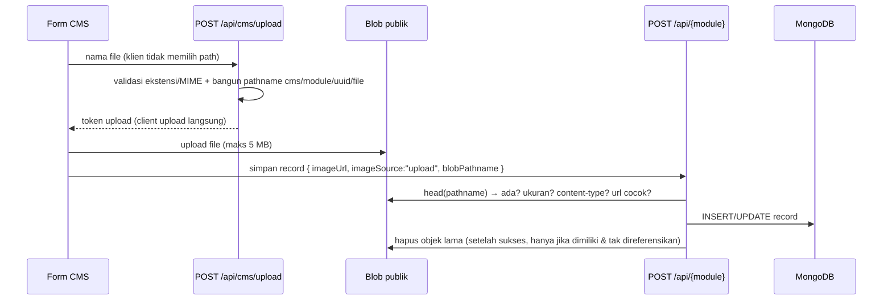
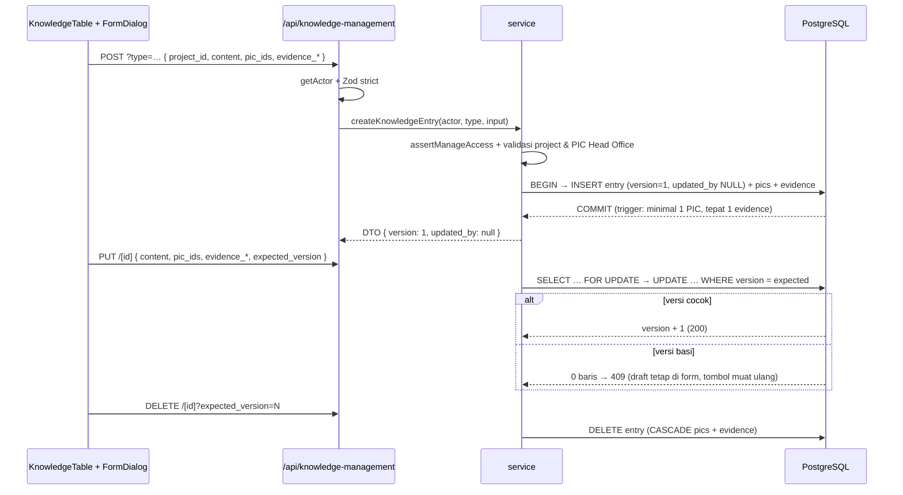
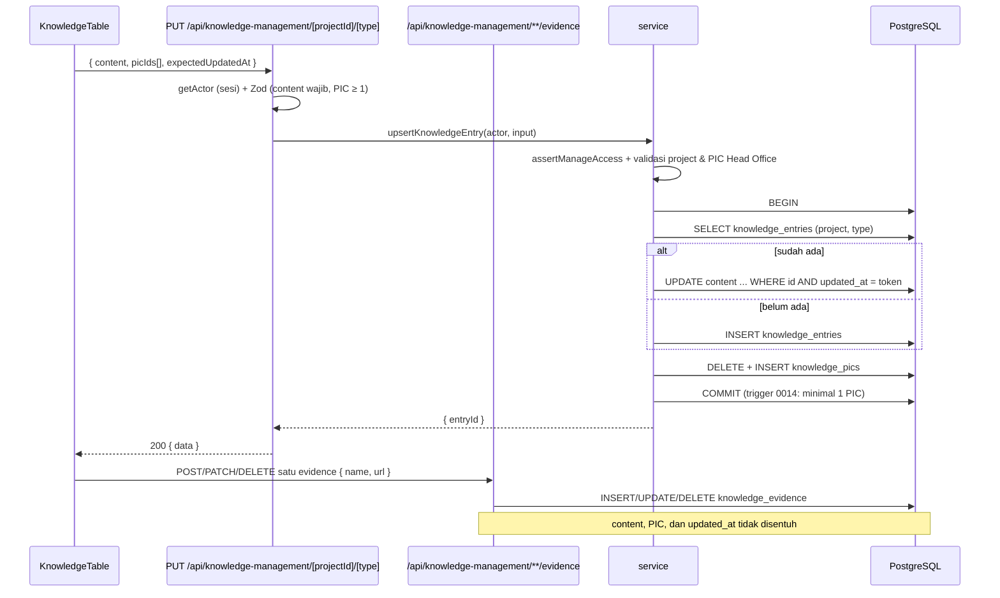

# 08 — BUSINESS PROCESS AND DATA FLOW

Diagram dan langkah di bawah hanya memuat alur yang terbukti dari kode.

## 1. Login

```
1. User mengisi NIP + password (+ "Ingat Sesi Kerja").
2. POST /api/auth/login → Zod parse.
3. evaluateLoginThrottle(nip) → 429 bila 5 kegagalan dalam 15 menit.
4. getUserForLoginByNip → bcrypt.compare (dummy hash bila user tidak ada).
5. Gagal → recordLoginAttempt(false) → 401 generik.
6. Suspended → 403 (tanpa menulis attempt).
7. Sukses → recordLoginAttempt(true) → INSERT sessions (SHA-256 token) → cookie httpOnly.
8. redirect ke /dashboard.
```

## 2. Membuka Dashboard

```
1. dashboard/layout.tsx → requireUser() (cookie → hash → sessions → users).
2. Tidak valid/suspended → redirect /login.
3. Kirim { name, role, mslAccess } ke DashboardShell.
4. Sidebar menghitung 8 flag visibilitas dari permission (bukan role literal).
5. Layout modul (mis. program-kerja) memeriksa canViewProgramKerja → redirect /dashboard bila tidak berhak.
6. Halaman klien fetch API modul; API memeriksa sesi + permission lagi.
```

## 3. Membuat Program Kerja (transaksi)



Aturan: `year` immutable; `unit` terkunci setelah ada RI; PIC wajib Head Office.

## 4. Mengisi RI

```
PATCH /api/program-kerja/[id]/ri { month, value }
→ actor dari sesi; isAssignedPic dihitung dari tabel program_kerja_pics
→ canUpdateProgramRi(role, isPIC): Admin selalu; Head Office hanya jika PIC
→ UPDATE program_kerja_monthly SET ri_value, ri_updated_by, ri_updated_at
→ summary/KPI dihitung ulang saat dibaca (tidak ada kolom total)
```

## 5. Upload Gambar CMS



Kegagalan di langkah hapus **tidak** menggagalkan penyimpanan (dicatat `console.warn`, alasan `failed`).

## 6. Upload Dokumen Template & Form (privat)

```
1. POST /api/template-form/upload → token Blob privat (template-form/...), maks 50 MB.
2. Klien upload ke store privat.
3. POST /api/template-form { sourceType:"upload", blobPathname, fileUrl, ... }.
4. Service: head(blob) → ada, ukuran ≤50 MB, ukuran klien == ukuran objek,
   probe isBlobPubliclyReachable (objek privat tidak boleh 2xx anonim).
5. INSERT baris; CHECK integritas memastikan hanya satu sumber.
6. Download: GET /api/template-form/[id]/file → cek sesi + view → stream privat.
```

## 7. Penilaian MSL

```
GET /api/msl?year=2026&month=9
→ canViewMsl (Admin / Head Office / Management+mslAccess)
→ proyek dari master_projects WHERE year=2026
→ assessment bulan 9 + catatan tahun
→ skor & kategori dihitung di server dari 3 komponen (tidak disimpan)

POST /api/msl/assessments { projectId, month, 3 komponen, remarks }
→ canManageMsl → proyek ada? → (project, month) belum ada? → INSERT numeric(3,2)
→ 409 bila duplikat; 404 bila proyek hilang; 403 bila tidak berhak
```

Setiap bulan independen: tidak ada aturan urutan, tidak ada syarat bulan sebelumnya.

## 8. Mengganti Struktur Organisasi

```
PUT /api/organization-structure { imageUrl, blobPathname }
→ ORGANIZATION_STRUCTURE_MANAGE (Admin) di route + assert di service
→ verifikasi objek di cms/organization/ (ada, ≤5 MB, tipe gambar, url cocok)
→ upsert baris singleton (maks satu baris dijamin CHECK+UNIQUE)
→ hapus objek lama bila berbeda dan tidak direferensikan
```

## 9. Hapus Master Project

```
DELETE /api/master-project/[id]
→ MASTER_PROJECT_DELETE (Admin/Head Office)
→ DELETE ... ; FK RESTRICT dari engineering_database_entries & msl_assessments
→ pelanggaran FK → 409, bukan 500
```

## 10. Ketergantungan Lintas Modul

| Dari | Ke | Sifat | Bukti |
|---|---|---|---|
| Engineering DB | Master Project | wajib ada; hapus proyek ditolak | FK `project_id` RESTRICT |
| MSL | Master Project | tahun & daftar proyek | `master_projects.year` |
| MSL | Users | `msl_access` | `users.msl_access` |
| Program Kerja | Users | PIC + `created_by` | FK NO ACTION |
| Template & Form | Users | PIC Head Office | `validateUploaderPic` |
| Semua CMS | Blob publik | gambar | `lib/cms/image-storage.ts` |
| Struktur Organisasi | Blob publik | gambar chart | `cms/organization/` |

Tidak ada ketergantungan CMS ↔ PostgreSQL selain registry referensi gambar (yang membaca 6 repository untuk mencegah hapus objek terpakai).

## 11. Titik Gagal yang Sudah Ditangani

| Gagal | Perilaku |
|---|---|
| Mongo tidak tersedia | feed publik gagal → landing empty state; CMS menampilkan error |
| PostgreSQL tidak tersedia | API 500 terkontrol; login gagal dengan pesan |
| Blob tidak dikonfigurasi | 503 dengan pesan jelas (bukan 500) |
| Blob gagal saat hapus | dicatat, penyimpanan tetap sukses |
| NIP tidak dikenal | bcrypt dummy dijalankan, 401 generik |
| Login berulang | 429 + `Retry-After`, tanpa menulis attempt baru |

## 12. Knowledge Management (V1 → V2, 5 November 2026)



- **Add** lewat modal: combobox Master Project (search `project-options`), content (counter 20.000), PIC multi-select Head Office, evidence name/URL. Sukses → modal tertutup, tabel di-refresh, toast.
- **Edit** memakai modal yang sama; Master Project read-only; history menampilkan Created/Updated (Updated = `—` sampai update pertama).
- **Delete** permanen dengan dialog konfirmasi; `expected_version` ikut dikirim, 409 bila data berubah.
- **Konkurensi** berbasis integer `version` (bukan timestamp): dua update paralel → satu 200, satu 409; retry dengan versi terbaru diterima.
- **Integritas:** `project_id`/`knowledge_type` immutable (trigger), evidence tepat satu (UNIQUE + deferred trigger), PIC minimal satu (deferred trigger), FK project RESTRICT.
- **Status verifikasi:** concurrency 4/4 PASS, regresi 7/7 PASS, Admin PASS, Head Office/Management/Project **BLOCKED**. Detail: `DL-2026-11-05-02`.

### Alur V1 (historis — SUPERSEDED)



- **Membaca daftar:** `GET ?type=…` mengembalikan **semua** Master Project (LEFT JOIN). Proyek tanpa record tetap tampil dengan kolom knowledge kosong — tidak ada baris database yang dibuat hanya untuk itu.
- **Inline save (content + PIC):** satu transaksi hanya menulis content dan daftar PIC; evidence tidak ikut diganti. Karena itu menyimpan konten tidak pernah menghapus evidence.
- **Evidence per baris:** `POST /[projectId]/[type]/evidence` menambah satu baris, `PATCH/DELETE /evidence/[id]` mengubah/menghapus satu baris. Operasi ini tidak menyentuh content, PIC, maupun `updated_at`. Record harus sudah ada; bila belum → 404 dengan pesan untuk menyimpan konten dan PIC lebih dulu.
- **Konkurensi:** token `expectedUpdatedAt` berupa string timestamp UTC mikrodetik dan dibandingkan eksak di database; hanya berlaku pada content + PIC. Editor kedua — termasuk yang menyimpan dalam milidetik yang sama — menerima 409 dan diminta memuat ulang. Timestamp baru dijamin naik ketat (minimal +1 mikrodetik), sehingga replay token lama tidak pernah diterima.
- **Status acceptance:** Admin **PASS**; uji HTTP dua penulis simultan **NOT RUN** (tanpa lingkungan terisolasi); Head Office/Management/Project **BLOCKED** (tanpa kredensial/handoff).
- **Menghapus:** `DELETE /entry/[id]` **405** (dinonaktifkan); evidence dihapus satu per satu dari kolom Evidence, PIC minimal satu dijaga trigger.
- **Duplikasi:** `UNIQUE(project_id, knowledge_type)` menolak record kedua untuk submenu yang sama (409).
- **Hapus Master Project:** ditolak **409** bila proyek masih memiliki knowledge (FK RESTRICT), sehingga knowledge tidak hilang tanpa disadari.
- **Akses:** Admin/Head Office mengelola; Management/Project hanya membaca. Project tidak memperoleh akses ke halaman Program Kerja lain.
