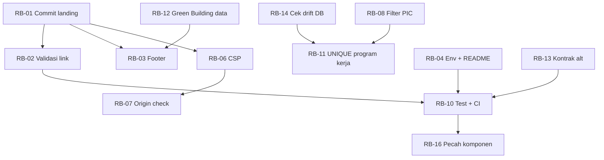

# 25 — TECHNICAL REMEDIATION ROADMAP

Rencana perbaikan BDWIKA / WIBEX berdasarkan kondisi repository aktual (HEAD `84e0a90`, 3 November 2026).
**Dokumen ini perencanaan saja.** Tidak ada source, database, konfigurasi, dependency, atau Git yang diubah. Implementasi menunggu persetujuan.

Sumber: `23-SECOND-PASS-GAP-REGISTER.md` (20 gap), `24-SECOND-PASS-AUDIT-REPORT.md`, `FINAL_EXECUTIVE_REPORT.md`, `AI_DEVELOPER_HANDOFF_GUIDE.md`, `docs/development/CURRENT_PROJECT_STATE.md`, dokumen 01–14.

## 1. Prinsip Perencanaan

1. **Bukti dulu, bukan rekomendasi audit.** Setiap item roadmap berasal dari gap dengan lokasi file dan bukti yang sudah diverifikasi. Rekomendasi audit **tidak otomatis** menjadi kebutuhan bisnis.
2. **Amankan pekerjaan yang belum tersimpan lebih dulu.** Working tree berisi 5 file landing belum di-commit; setiap perubahan lain berisiko menimpanya.
3. **Verifikasi sebelum memperbaiki.** Tiga hal tidak boleh "diperbaiki" sebelum dipastikan: drift DB produksi, penyebab feed Green Building kosong, dan niat bisnis di balik constraint/opsi PIC.
4. **Satu perubahan = satu tujuan.** Tidak mencampur perbaikan keamanan dengan refactor.
5. **Modul protected tidak disentuh** (MSL Engineering, Struktur Organisasi) kecuali ada persetujuan eksplisit.
6. **Tidak ada klaim PASS tanpa eksekusi.** Setiap wave punya gate verifikasi.

## 2. Klasifikasi 20 Gap + Temuan F-series

### 2.1 Masalah produk (perilaku terlihat pengguna)
| ID | Masalah | Bukti |
|---|---|---|
| GAP-11 / F-16 | Footer: 3 ikon sosial + 5 tautan legal `href="#"`; email `mailto:` ≠ teks | `Footer.tsx` 4–10, 148–206 |
| GAP-12 / F-09 | Permission SASAA tanpa modul | `permissions.ts` 36, 79 |
| LP-NAV-002 | CTA Portal tab baru belum diverifikasi visual | `Navbar.tsx` 127–129 |
| F-03 | `imageAlt`/`description` tak bisa diedit dari form | schema vs form CMS |
| F-11 | Feed Green Building publik 0 item | `/api/green-buildings/public` |
| F-07 | Nama fallback fiktif di header dashboard | `DashboardHeader.tsx` |

### 2.2 Masalah keamanan
| ID | Masalah | Severity |
|---|---|---|
| F-01 | CSP tidak dipasang | HIGH |
| F-02 | `link` CMS tidak divalidasi server | HIGH |
| F-10 | Tanpa cek Origin/CSRF pada mutasi | LOW |
| GAP-15 / F-18 | Opsi PIC tidak memfilter akun suspended | MEDIUM |
| F-17 | `apiAuthGuard` dead helper | LOW |
| SEC-05 | Tidak ada rate limit selain login | LOW |

### 2.3 Masalah arsitektur / kualitas
| ID | Masalah | Catatan |
|---|---|---|
| F-05 | 0 test, tanpa CI | risiko regresi tertinggi jangka panjang |
| F-06 | 5 file > 700 baris | refactor berisiko, tunda |
| GAP-09 / GAP-18 | Pola `_helpers.ts` tidak terdokumentasi (sudah diperbaiki di dokumen) | selesai dokumentasi |
| GAP-16 | Tidak ada `error.tsx`/`loading.tsx`/`not-found.tsx` | UX kegagalan |
| F-08 | Index Mongo dibuat lazy | operasional |
| F-15 | `lib/demo/*` menyesatkan | penamaan |

### 2.4 Masalah dokumentasi (sudah diperbaiki pada second pass)
| ID | Status |
|---|---|
| GAP-01, 02, 03, 04, 05, 06, 07, 08, 18, 19, 20 | **CLOSED** — dokumen sudah dikoreksi, tidak ada pekerjaan kode |
| GAP-09 (pola helper) | CLOSED untuk dokumentasi; tidak perlu perubahan kode |

### 2.5 Business rules yang belum jelas
| ID | Pertanyaan | Mengapa butuh keputusan |
|---|---|---|
| GAP-13 / F-19 | Bolehkah dua Program Kerja bernama sama dalam grup+tahun sama? | menentukan perlu UNIQUE + migration |
| F-03 | `imageAlt`/`description` dihapus permanen dari produk atau dikembalikan? | mengubah kontrak API + form |
| GAP-15 / F-18 | PIC non-aktif boleh dipilih? | keputusan operasional V1 |
| GAP-12 | Apakah Dashboard SASAA akan dibangun? | menentukan permission dipertahankan |
| — | Kebijakan "frozen" MSL & Struktur Organisasi | menentukan boleh/tidaknya refactor |

## 3. Model Prioritas

| Prioritas | Kriteria | Wajib sebelum |
|---|---|---|
| **P0 — Lindungi & verifikasi** | mencegah kehilangan pekerjaan atau salah diagnosis | semua wave lain |
| **P1 — Keamanan & integritas** | celah yang bisa dieksploitasi atau merusak data | rilis berikutnya |
| **P2 — Ketahanan & observability** | mencegah regresi senyap | sebelum modul baru |
| **P3 — Keputusan bisnis** | butuh persetujuan pemilik | setelah keputusan |
| **P4 — Struktural** | biaya perubahan tinggi, manfaat jangka panjang | setelah test/CI ada |

## 4. Dependency Graph

Aturan: **RB-01 adalah prasyarat semua perubahan kode** karena working tree belum bersih. **RB-10 (test/CI) adalah prasyarat refactor RB-16.**

## 5. Wave dan Gate

### Wave 0 — Dokumentasi (SELESAI)
- Isi: koreksi 12 dokumen + 2 dokumen baru (23, 24).
- Gate: konsistensi angka terverifikasi (`grep`), tidak ada tautan rusak, kode tidak berubah.
- Status: **DONE**.

### Wave 1 — Lindungi & perbaiki celah langsung (P0/P1)
| Item | Ringkas | Kompleksitas |
|---|---|---|
| RB-01 | Commit pekerjaan landing terpisah per topik | LOW |
| RB-02 | Validasi `link` di Zod + sanitasi konsisten | LOW |
| RB-03 | Footer: samakan `mailto:`, non-aktifkan tautan placeholder | LOW |
| RB-14 | Verifikasi drift DB (read-only) | LOW (butuh akses) |
| RB-12 | Pastikan penyebab feed Green Building kosong | LOW (butuh akses) |

**Gate Wave 1:** `tsc --noEmit` 0, ESLint file berubah 0, `git diff --check` 0, working tree bersih dari pekerjaan lama, laporan verifikasi DB/Green Building tersedia.

### Wave 2 — Hardening (P1/P2)
| Item | Ringkas | Kompleksitas |
|---|---|---|
| RB-06 | CSP Report-Only → enforce bertahap | MEDIUM |
| RB-07 | Helper `assertSameOrigin` untuk mutasi | LOW |
| RB-09 | `error.tsx`, `not-found.tsx`, `loading.tsx` | LOW |
| RB-05 | Hapus/tandai `apiAuthGuard` | LOW |
| RB-08 | Filter status opsi PIC | LOW–MEDIUM |

**Gate Wave 2:** CSP tidak memblokir gambar Blob/`style` inline pada landing & dashboard (uji manual terkontrol), 403 untuk Origin asing, halaman error tidak membocorkan stack.

### Wave 3 — Ketahanan (P2)
| Item | Ringkas | Kompleksitas |
|---|---|---|
| RB-10 | Unit test murni + CI dasar | MEDIUM |
| RB-04 | `.env.example` ter-track + README nyata | LOW |
| RB-15 | Skrip index Mongo idempoten | LOW |

**Gate Wave 3:** CI menjalankan `tsc` + `eslint` + unit test; test menutup skor MSL, summary, permission, sanitasi URL, allowlist MIME.

### Wave 4 — Keputusan bisnis (P3)
| Item | Butuh keputusan |
|---|---|
| RB-11 | UNIQUE domain Program Kerja + migration |
| RB-13 | Kontrak `imageAlt`/`description` |
| RB-20 | Dashboard SASAA (bila dilanjutkan) |

**Gate Wave 4:** keputusan tertulis pemilik + migration direview + rencana rollback.

### Wave 5 — Struktural (P4, ditunda)
| Item | Alasan tunda |
|---|---|
| RB-16 | Pecah komponen > 700 baris — hanya bila area itu akan diubah |
| RB-17 | Rename `lib/demo` — churn tinggi, manfaat rendah |
| RB-18 | Hapus SVG default — kosmetik |

## 6. Apa yang Harus Diperbaiki Lebih Dulu

1. **RB-01** — commit pekerjaan landing (mencegah kehilangan 109 baris perubahan).
2. **RB-02** — validasi `link` (celah HIGH, perbaikan kecil, tanpa dependency).
3. **RB-14** — verifikasi drift DB (mencegah migration yang salah).
4. **RB-03** — footer (dampak reputasi langsung pada halaman publik).
5. **RB-10** — test + CI (prasyarat semua perubahan berikutnya yang lebih besar).

## 7. Apa yang Harus Diverifikasi Lebih Dulu (bukan diperbaiki)

| Verifikasi | Mengapa | Cara |
|---|---|---|
| Drift schema vs DB produksi | migration mungkin belum diterapkan | `drizzle-kit check` / bandingkan `information_schema` di environment aman (bukan saat audit) |
| Penyebab feed Green Building kosong | bisa data, bukan bug kode | inspeksi `publishStatus`/`status` pada koleksi, read-only |
| Tab baru `/login` | tooling audit tidak dapat mengamati tab baru | klik manual di browser |
| Status deployment Vercel & domain | tidak ada akses | konfirmasi pemilik |
| Niat bisnis UNIQUE Program Kerja | tidak ada komentar/kode yang menyatakan | keputusan pemilik |

## 8. Apa yang Dapat Ditunda

- Refactor komponen > 700 baris (F-06), rename `lib/demo` (F-15), hapus SVG default (F-14).
- Skrip index Mongo (F-08) — hanya operasional.
- Dashboard SASAA — belum ada spesifikasi.
- Pemisahan `_helpers.ts` menjadi helper bersama — saat ini duplikasi disengaja dan aman.

## 9. Persetujuan yang Dibutuhkan (NEEDS_BUSINESS_APPROVAL)

| ID | Keputusan | Dampak bila salah |
|---|---|---|
| D-01 | Apakah duplikasi nama Program Kerja diperbolehkan (GAP-13) | UNIQUE yang salah dapat menolak data valid |
| D-02 | Apakah `imageAlt`/`description` dikembalikan ke form atau dihapus dari API (F-03) | perubahan kontrak API + data lama |
| D-03 | Apakah PIC non-aktif boleh dipilih (F-18) | alur RI bisa macet |
| D-04 | Kebijakan "frozen" MSL & Struktur Organisasi | refactor pada modul protected |
| D-05 | URL resmi sosial/legal footer (GAP-11) | tautan mati berlanjut |
| D-06 | Apakah CSP langsung enforce atau Report-Only lebih dulu | potensi memblokir aset produksi |
| D-07 | Apakah `.env.example` boleh di-track (mengubah `.gitignore`) | perubahan kebijakan repo |

## 10. Aturan Urutan Implementasi

1. **Tidak ada perubahan kode sebelum RB-01 selesai** (working tree bersih untuk file yang bersangkutan).
2. **Satu commit per item backlog**, dengan pesan yang menyebut ID (`RB-02: ...`).
3. **Item keamanan tidak digabung** dengan refactor atau perubahan UI.
4. **Migration hanya setelah RB-14** dan hanya untuk keputusan yang sudah disetujui.
5. **Refactor hanya setelah RB-10** (test/CI) tersedia.
6. **Modul protected** hanya disentuh setelah D-04.

## 11. Cara Memastikan Perubahan Tidak Merusak Fitur Lain

| Lapis | Mekanisme |
|---|---|
| Sebelum | baca dokumen 23/24 + `git status`; identifikasi modul terdampak lewat `27-CHANGE-IMPACT-ANALYSIS.md` |
| Saat | perubahan terisolasi per file; tidak mengubah signature publik tanpa kebutuhan; tidak menyentuh 5 repository CMS sekaligus |
| Sesudah | `tsc --noEmit`; ESLint file berubah; `git diff --check`; uji manual minimal pada modul terdampak; untuk storage: uji upload + hapus |
| Jangka panjang | RB-10 (unit test + CI) menggantikan ketergantungan pada verifikasi manual |

## 12. Exit Criteria Roadmap

- [ ] RB-01…RB-03 selesai dan terverifikasi.
- [ ] Drift DB dan penyebab Green Building kosong terjawab.
- [ ] Keputusan D-01…D-07 tercatat.
- [ ] CSP aktif tanpa memblokir aset.
- [ ] CI berjalan pada setiap push.
- [ ] Tidak ada perubahan pada modul protected tanpa persetujuan.
- [ ] Dokumentasi audit diperbarui bila ada kontrak yang berubah.
