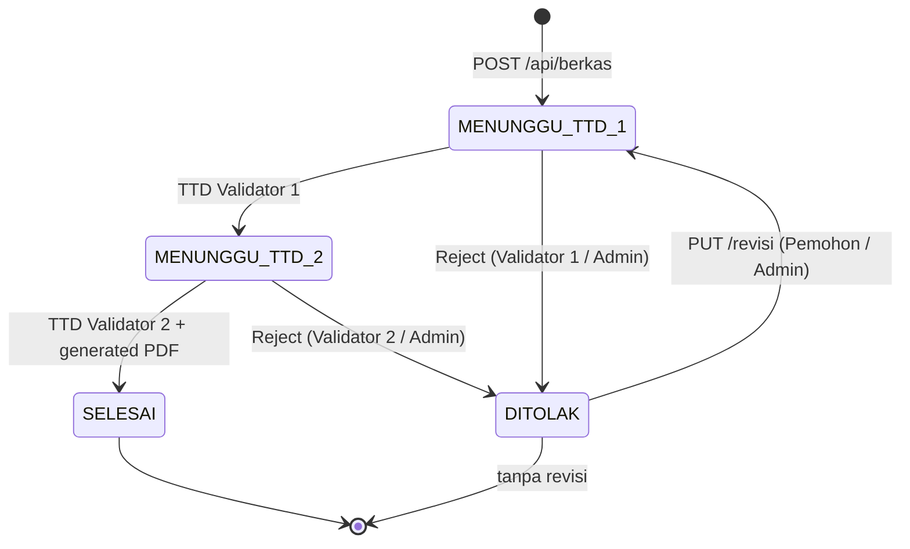

# P3 — Technical Design: Sprint 2 Modul Berkas

**Proyek:** WIBEX — Staff Engineering Digitalisasi Building
**Fase:** P3 — Technical Design Sprint 2 · **Tanggal:** 2026-11-11
**Baseline:** `main` @ `0805776` — Modul Berkas V1 `IMPLEMENTED & VERIFIED`
**Input:** Audit P2 Modul Berkas + requirement Sprint 2
**Status:** Desain selesai — menunggu review Owner/ChatGPT · **Implementasi:** belum

> Dokumen ini hanya desain. Tidak ada source code, dependency, migration, commit,
> atau push. Migration **0023** dirancang di sini dan dibuat pada fase implementasi.

---

## A. Executive Summary

Sprint 2 menutup empat masalah audit P2: otorisasi validator, integritas data,
orphan blob, dan keterbatasan operasional (reject/revisi, navigasi data).

| Area | Keputusan |
|---|---|
| Validator | `user-options` hanya Admin/HO/Management; `BERKAS_VALIDATE` ditegakkan |
| Kode seri | Partial UNIQUE; banyak `NULL` tetap diizinkan |
| Page count | Dihitung server dengan `pdf-lib`; nilai client hanya petunjuk |
| Status | Tambah `DITOLAK`; reject oleh validator slot aktif atau Admin |
| Revisi | Pengaju/Admin upload PDF baru; reset ke `MENUNGGU_TTD_1` |
| Pagination | `GET /api/berkas?search=&page=&limit=` + `totalData` |
| Cleanup | Helper best-effort pada kegagalan create/revisi/TTD |
| Tech debt | `updateStatus()` dihapus; batas catatan UI 2000 |

Prinsip tetap: pathname Blob bukan identitas record, actor dari sesi, dan setiap
transisi memakai optimistic concurrency (`version`) + row lock.

---

## B. Requirement Traceability

| ID | Requirement | Keputusan | Bagian |
|---|---|---|---|
| S2-01 | Filter role validator | Allowlist role di service | C.1, E.4 |
| S2-02 | `kode_seri` UNIQUE | Partial unique + trim + 409 | C.2 |
| S2-03 | Page count server | `pdf-lib` sebelum insert | C.3 |
| S2-04 | Orphan blob cleanup | Helper + call-site matrix | F |
| S2-05 | Status `DITOLAK` | CHECK baru + kolom audit | C.1, C.4, D |
| S2-06 | `POST /reject` | Validator slot aktif atau Admin | E.2 |
| S2-07 | `PUT /revisi` | Pemohon/Admin; reset status & TTD | E.3 |
| S2-08 | Search & pagination | Query server + `totalData` | E.1 |
| S2-09 | Hapus `updateStatus` | Transisi dipusatkan | I |
| S2-10 | Catatan 2000 | UI disamakan dengan schema | G.2 |

---

## C. Database Schema Update

### C.1 Status dan kolom reject

`BERKAS_STATUSES` menjadi empat nilai (`src/lib/pg/schema.ts:18-24`):

```text
MENUNGGU_TTD_1 | MENUNGGU_TTD_2 | SELESAI | DITOLAK
```

Kolom baru `berkas_pengajuan`:

| Kolom | Tipe | Null | Keterangan |
|---|---|---|---|
| `rejection_reason` | text | yes | Alasan penolakan, 1–2000 karakter |
| `rejected_at` | timestamptz | yes | Waktu penolakan |
| `rejected_by` | uuid | yes | FK `users.id`, `NO ACTION` |
| `revision_count` | integer | no | Default 0; `>= 0` |

`rejection_*` menyimpan penolakan terakhir dan dipertahankan setelah revisi sebagai
jejak audit minimal. Tidak ada tabel audit baru pada sprint ini.

### C.2 Unique `kode_seri`

- Nilai di-`trim()` di service sebelum insert/update.
- Partial unique index `berkas_pengajuan_kode_seri_unique (kode_seri) WHERE
  kode_seri IS NOT NULL`; banyak `NULL` tetap boleh.
- Duplikat → `409 KODE_SERI_DUPLICATE`, bukan 500.
- Preflight migration:

```sql
select kode_seri, count(*) from berkas_pengajuan
where kode_seri is not null group by kode_seri having count(*) > 1;
```

Duplikat existing harus dirapikan manual; migration tidak mengubah nilai otomatis.

### C.3 Validasi page count server-side

`verifyPrivateBlob()` saat ini hanya metadata (`service.ts:335-360`). Pada create
dan revisi ditambahkan:

1. Baca byte PDF privat (`openBlobDownload`).
2. `PDFDocument.load(bytes)` tanpa `ignoreEncryption`; rusak/terenkripsi → 422.
3. `getPageCount()` wajib 1–200.
4. Nilai server menjadi `original_pdf_page_count`; `originalPdf.pageCount` client
   hanya petunjuk dan tidak pernah disimpan.

Ini juga menolak file yang MIME-nya benar tetapi isinya bukan PDF valid.

### C.4 Migration `0023_berkas_sprint2`

Rancangan isi (belum dibuat):

1. Tambah kolom `rejection_reason text`, `rejected_at timestamptz`,
   `rejected_by uuid` (FK users, NO ACTION), `revision_count integer NOT NULL
   DEFAULT 0`.
2. `DROP CONSTRAINT berkas_pengajuan_status_check`, tambah CHECK empat status.
3. CHECK tambahan:
   - `rejection_reason is null or length(btrim(rejection_reason)) between 1 and 2000`
   - `revision_count >= 0`
   - `(status = 'DITOLAK') = (rejected_at is not null and rejected_by is not null
     and rejection_reason is not null)`
4. Buat partial unique index `berkas_pengajuan_kode_seri_unique` pada `kode_seri`.
5. Index existing `(status, created_at)` tetap dipakai untuk filter status.

Constraint existing tetap: `completed_at` wajib null untuk `DITOLAK`
(`completion_check`), metadata generated wajib null (`generated_state_check`),
`version >= 1`, dan `original_pdf_*` tidak berubah.

Rollback: hapus index dan empat kolom, kembalikan CHECK tiga status. Rollback hanya
aman jika tidak ada baris `DITOLAK`.

---

## D. State Machine



| Dari | Event | Guard | Ke | Efek |
|---|---|---|---|---|
| — | Create | Create access, aset valid, page count server | `MENUNGGU_TTD_1` | Parent + child; `version=1` |
| `MENUNGGU_TTD_1` | TTD 1 | Validator 1, `BERKAS_VALIDATE`, TTD kosong | `MENUNGGU_TTD_2` | Isi TTD 1; `version+1` |
| `MENUNGGU_TTD_2` | TTD 2 | Validator 2, `BERKAS_VALIDATE`, TTD 1 ada | `SELESAI` | TTD 2; generated PDF; `completed_at` |
| `MENUNGGU_TTD_1` | Reject | Validator 1 atau Admin; alasan 1–2000 | `DITOLAK` | `rejection_*`; `version+1`; TTD tetap |
| `MENUNGGU_TTD_2` | Reject | Validator 2 atau Admin; alasan 1–2000 | `DITOLAK` | `rejection_*`; TTD 1 dipertahankan |
| `DITOLAK` | Revisi | Pemohon/Admin; PDF baru valid | `MENUNGGU_TTD_1` | Ganti PDF; reset TTD validator; `catatan=null`; `revision_count+1` |
| `SELESAI` | Reject/Revisi/TTD | — | tetap | 409 |

Aturan:

- `DITOLAK` bukan state sementara; tidak ada TTD sampai revisi.
- Reject tidak menghapus blob. Revisi menghapus objek lama setelah commit.
- Revisi mengosongkan **kedua** slot TTD validator dan blob TTD lama karena tanda
  tangan melekat pada PDF yang diganti. TTD penyusun dipertahankan.
- Revisi tidak mengubah `judul`/`kode_seri`; perubahan identitas di luar scope.
- `submitted_at` tetap waktu pengajuan pertama; `revision_count` menandai revisi.
- Semua transisi memakai `FOR UPDATE` + `version`; dua reject/revisi bersamaan → 409.

---

## E. API Contract

### E.1 `GET /api/berkas` — search & pagination

| Param | Default | Aturan |
|---|---|---|
| `search` | — | Trim, maks 100 karakter; ILIKE `judul`, `kode_seri`, `pemohon.name`; wildcard di-escape |
| `page` | 1 | Integer `>= 1`; invalid → 400 |
| `limit` | 10 | Integer 1–100; invalid → 400 |

Scope tetap: Project hanya record miliknya; HO/Management/Admin melihat semua.
Urutan `created_at DESC, id DESC`.

Response `200`:

```json
{
  "data": [ { "id": "uuid", "judul": "...", "kodeSeri": "...", "status": "DITOLAK",
              "rejectionReason": "...", "revisionCount": 1 } ],
  "assignments": [ { "berkasId": "uuid", "urutan": 2, "ttdUploadedAt": null } ],
  "pagination": { "page": 1, "limit": 10, "totalData": 42, "totalPages": 5 }
}
```

- `assignments` hanya untuk `berkasId` halaman ini; `totalData` dari count filter
  yang sama. Page melebihi total → `data: []`, `totalData` tetap benar (bukan 404).
- Record `DITOLAK` menyertakan `rejectionReason`, `rejectedAt`, `revisionCount`.

Repository: `listBerkasPage({ pemohonId?, search?, page, limit })` →
`{ rows, totalData }`; `listBerkasAssignmentsByUser(actorId, berkasIds)`.

### E.2 `POST /api/berkas/[id]/reject`

Auth: sesi aktif. Guard: Admin **atau** validator slot yang sedang menunggu dan
memegang `BERKAS_VALIDATE`.

```json
{ "reason": "Dokumen belum ditandatangani penyusun." }
```

- `reason` wajib, trim 1–2000 karakter.
- Hanya dari `MENUNGGU_TTD_1` (validator 1/Admin) atau `MENUNGGU_TTD_2`
  (validator 2/Admin).
- `version` opsional di body; jika dikirim dan tidak cocok → 409.
- Efek: `status=DITOLAK`, `rejection_reason`, `rejected_by=actor.id`,
  `rejected_at=now`, `version+1`, `updated_at=now`; TTD/blob tidak diubah.
- Response `200`: detail terbaru termasuk `rejectionReason`.
- Error: 400 alasan, 401, 403 bukan slot/Admin atau tanpa `BERKAS_VALIDATE`, 404,
  409 status/versi.

### E.3 `PUT /api/berkas/[id]/revisi`

Auth: pemohon (`pemohon_id = actor.id`) dengan `BERKAS_CREATE`, atau Admin.

```json
{
  "uploadId": "uuid-batch-baru",
  "originalPdf": {
    "pathname": "berkas/uploads/<actor>/<uploadId>/original/<uuid>.pdf",
    "fileName": "berita-acara-revisi.pdf"
  }
}
```

1. Status wajib `DITOLAK`; selain itu 409.
2. Pathname cocok dengan actor + `uploadId` baru, kind `original`.
3. `headBlob`: ada, privat, MIME PDF, 1 byte–20 MB.
4. Server membaca PDF: valid, tidak terenkripsi, 1–200 halaman.
5. Transaksi: ganti `original_pdf_pathname/name/mime/size/page_count`; set
   `status=MENUNGGU_TTD_1`, `catatan=null`, `completed_at=null`,
   `generated_*=null`, `revision_count+1`, `version+1`; kosongkan semua kolom TTD
   `berkas_validasi`; pertahankan `rejection_*` sebagai audit.
6. Setelah commit: hapus PDF lama + TTD validator lama (best-effort). Cleanup gagal
   tidak membatalkan record; orphan dicatat.

Response `200`: detail dengan `status=MENUNGGU_TTD_1`, `revisionCount` naik.
Error: 400 path/body, 401, 403 bukan pemohon/Admin, 404, 409 bukan `DITOLAK`/versi,
413 ukuran, 415 MIME, 422 PDF rusak/terenkripsi/page count, 502/503 storage.

### E.4 Perubahan guard existing

- `POST /api/berkas/[id]/ttd` dan `upload-token` validator: tambah
  `canValidateBerkas(actor.role)` sebelum cek assignment (`service.ts:862`).
- `GET /api/berkas/user-options`: filter role Admin/HO/Management dan status
  `active`; Project tidak muncul (`service.ts:595-608`).
- Validator tetap record-scoped: permission saja tidak cukup.
- Reject/Revisi memakai `mapDomainError()`; tambah code `KODE_SERI_DUPLICATE`,
  `INVALID_STATUS`, `INVALID_PDF`.

---

## F. Orphan Blob Cleanup

### F.1 Helper

Modul baru `src/lib/berkas/blob-cleanup.ts`:

```text
cleanupBerkasBlobs(pathnames: string[], context: {
  operation: "create" | "revisi" | "ttd" | "delete";
  berkasId?: string;
}): Promise<void>
```

- Deduplikasi pathname; abaikan nilai kosong.
- `Promise.allSettled(pathnames.map(deleteBlob))`; **tidak pernah throw**.
- Log jumlah/operasi/`berkasId`; jangan log pathname/token. Idempotent: objek hilang
  dianggap sukses.

### F.2 Call-site matrix

| Operasi | Kapan | Pathname dibersihkan | Urutan |
|---|---|---|---|
| Create | Validasi/insert gagal setelah upload | PDF asli + TTD penyusun batch | DB belum commit |
| Revisi | PUT gagal setelah PDF baru diunggah | PDF baru | DB belum berubah |
| Revisi sukses | Setelah commit | PDF lama + TTD validator lama | **Setelah** commit |
| TTD | POST gagal setelah upload | TTD validator baru | DB belum berubah |
| TTD 2 generate gagal | Generate/commit gagal | Generated PDF + TTD 2 baru | Existing |
| Delete Admin | Setelah row terhapus | PDF asli, generated, semua TTD | Setelah commit |
| Reject | — | — | Blob dipertahankan |

Upload yang dibatalkan client sebelum `POST /api/berkas` tidak diketahui server;
sweep berkala untuk `berkas/uploads/**` tanpa referensi DB direncanakan fase
berikutnya. Sprint ini fokus pada kegagalan yang teramati server.

---

## G. UI/UX Update

### G.1 Halaman Ajukan

- Toolbar: search (debounce 300 ms), select limit 10/25/50, total data.
- Search mereset `page` ke 1; Prev/Next + “Menampilkan X–Y dari N”.
- Empty state dibedakan: belum ada data vs tidak ada hasil pencarian.
- Badge `DITOLAK` rose/red; tombol **Revisi** hanya untuk pemohon/Admin, Download
  hanya `SELESAI`.
- Dialog Revisi: alasan terakhir, upload PDF baru, progress; sukses → reload + toast.

### G.2 Halaman Verifikasi

- Tombol **Tolak** muncul bila `canReject`:
  - Admin pada `MENUNGGU_TTD_1`/`MENUNGGU_TTD_2`; atau
  - validator slot aktif pada status sesuai, dengan `BERKAS_VALIDATE`.
- Dialog Tolak: textarea alasan wajib, counter 0/2000, konfirmasi.
- Baris `DITOLAK`: tampilkan alasan, tanpa tombol TTD; PDF tetap bisa dilihat.
- Catatan TTD naik dari 500 ke **2000** + counter (`BerkasTtdDialog`).
- Daftar memakai endpoint paginated; assignments hanya halaman aktif.

### G.3 Tipe dan label

- `BerkasStatus`/label/class tambah `DITOLAK`; DTO tambah `rejectionReason`,
  `rejectedAt`, `revisionCount`.
- `canSignBerkas()` selalu false untuk `DITOLAK`; helper baru
  `canRejectBerkas(status, assignment, isAdmin)`.

---

## H. Security & Integrity

| Risiko | Mitigasi |
|---|---|
| Project menjadi validator | Filter `user-options` + `BERKAS_VALIDATE` |
| Reject validator salah slot | Record-scoped: user + urutan + status |
| Revisi orang lain | `pemohon_id = actor.id` atau Admin; path actor/uploadId |
| Kode seri ganda | Partial unique; trim; unique violation → 409 |
| Page count dipalsukan | Server baca PDF; client hanya petunjuk |
| PDF rusak/terenkripsi | Load tanpa `ignoreEncryption`; 422 |
| Blob orphan | Cleanup best-effort + matrix F.2 |
| Race reject/revisi | `FOR UPDATE` + `version`; 409 |
| XSS alasan / path traversal | Teks biasa (bukan HTML); validasi storage-path + uploadId |

Mutasi same-origin, `Cache-Control: private, no-store`, pathname tidak masuk DTO.

---

## I. Tech Debt

1. **Hapus `updateStatus()`** (`service.ts:779-860`) + `BerkasStatusPatch` yang hanya
   dipakai fungsi itu. `ALLOWED_TRANSITIONS` dipindah ke `assertTransition(from, to)`
   yang dipakai TTD, reject, dan revisi.
2. **Pakai ulang/hapus `assertValidateAccess()`** setelah enforcement dipasang.
3. **Catatan 2000** di dialog TTD dan reject.
4. **Hapus fallback `pageCount` client** dari kontrak create; field opsional untuk
   kompatibilitas satu rilis.
5. Verifikasi `grep -rn "updateStatus" src` sebelum penghapusan.

---

## J. Implementation Plan & File Impact

| Langkah | Pekerjaan |
|---|---|
| 1 | `schema.ts`: status, kolom reject, index unik; migration 0023 + journal |
| 2 | Repository: pagination/count, assignment per ids, reject, revisi |
| 3 | Service: page count server, reject, revisi, cleanup, enforcement validator |
| 4 | Route: `[id]/reject`, `[id]/revisi`, GET query, user-options filter |
| 5 | UI: search/pagination/revisi; tolak & catatan 2000 |
| 6 | Test unit + route; typecheck, lint, test suite |
| 7 | Review manual: reject → revisi → TTD 1 → TTD 2 → PDF final |

File: `src/lib/pg/schema.ts`, `drizzle/0023_*`, `src/lib/berkas/{repository,service,
schema,blob-cleanup}.ts`, `src/app/api/berkas/route.ts`, `[id]/reject/route.ts`,
`[id]/revisi/route.ts`, `src/components/dashboard/berkas/*`, test terkait.

---

## K. Acceptance Criteria

- [ ] `user-options` tidak mengembalikan user Project/inactive.
- [ ] TTD/reject menolak actor tanpa `BERKAS_VALIDATE` atau bukan slot aktif.
- [ ] `kode_seri` sama → 409; `NULL` berulang tetap boleh.
- [ ] Create/revisi menyimpan page count hasil `pdf-lib`.
- [ ] PDF rusak/terenkripsi/>200 halaman ditolak 422 sebelum insert.
- [ ] Reject mengisi alasan/by/at dan status `DITOLAK`; TTD tidak bisa masuk.
- [ ] Revisi mengganti PDF, reset TTD validator, kembali ke `MENUNGGU_TTD_1`.
- [ ] Revisi menghapus PDF/TTD lama setelah commit tanpa merusak record.
- [ ] Create/TTD/revisi gagal tidak meninggalkan blob baru; GET mendukung
  search/page/limit + `totalData`/`totalPages`.
- [ ] `updateStatus` tidak ada dan tidak ada referensi rusak.
- [ ] Catatan TTD/reject menerima 2000 karakter.
- [ ] `tsc`, lint, test PASS; migration diuji lokal sebelum Vercel.

---

## L. Risks & Open Decisions

| Risiko/keputusan | Dampak | Mitigasi/default |
|---|---|---|
| Duplikat `kode_seri` existing | Migration 0023 gagal | Preflight query; rapikan manual |
| `pdf-lib` load PDF 20 MB | Memori/timeout | Batas 20 MB/200 halaman; Node runtime; `maxDuration` 60 |
| Reject setelah TTD 1 | TTD 1 tidak berlaku | Revisi hapus TTD 1 + blob; alasan tercatat |
| Cleanup gagal | Orphan tetap ada | Best-effort + log; sweep fase berikutnya |
| Count/list dua query; `ILIKE` tanpa index | Total tidak konsisten; search lambat | Urutan stabil; `pg_trgm` bila perlu |
| Revisi tidak ubah judul/kode | Identitas lama dipakai | Default sprint; di luar scope |
| Audit reject terbatas | Tidak ada riwayat semua reject | Kolom terakhir; audit penuh fase berikutnya |

**Open decision:** Validator 1 tidak boleh menolak saat `MENUNGGU_TTD_2` (hanya
validator slot aktif/Admin); Admin boleh merevisi dokumen milik orang lain.
