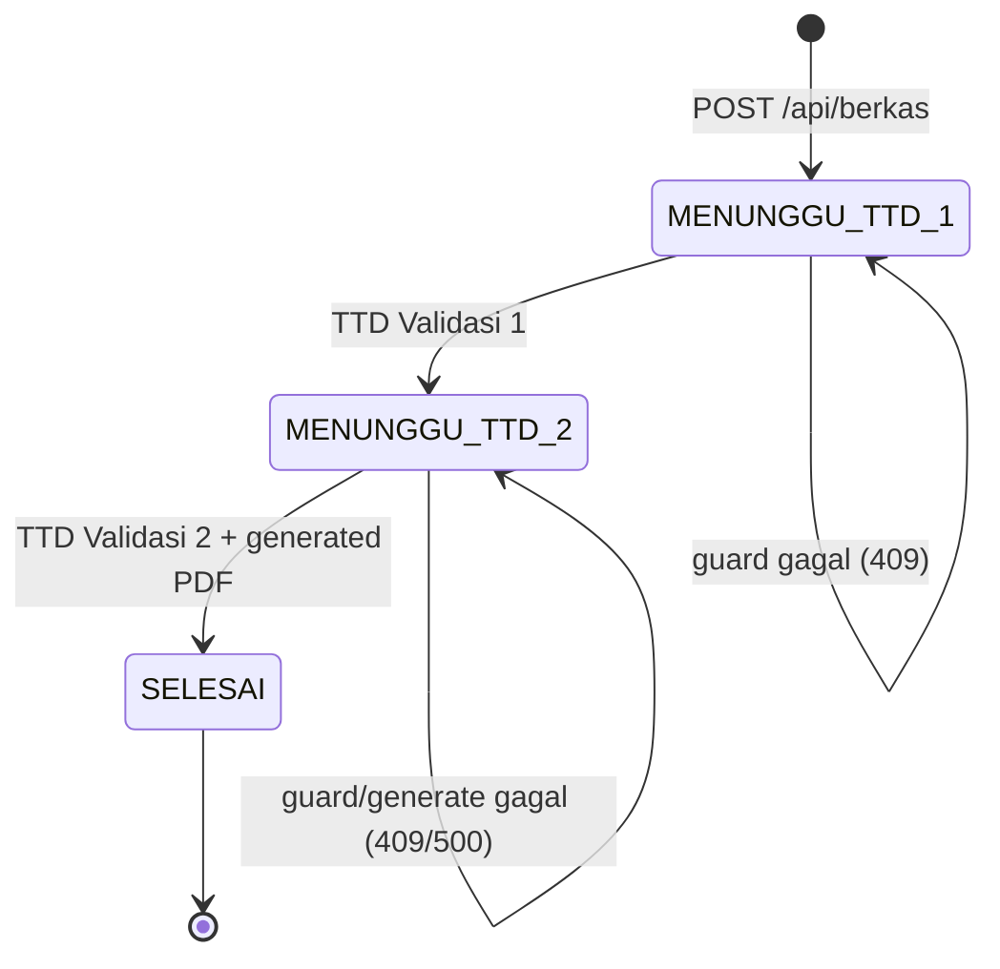

# P3 — Technical Design: Modul Berkas

**Proyek:** WIBEX — Staff Engineering Digitalisasi Building
**Fase:** P3 — Technical Design
**Tanggal:** 2026-11-10
**Baseline:** `main` @ `7e1b54d` — `docs: approve governance and elevate CST to verified`
**Input:** Audit P2 modul Berkas + keputusan desain Owner D-BERKAS-01…07
**Status:** Desain selesai — menunggu review Owner/ChatGPT
**P4:** Belum dimulai

> Baseline aktual memakai HEAD `7e1b54d`. Migration terakhir adalah
> `0019_project_documentation_period`; modul Berkas memakai migration **0020**.
> Tidak ada dependency yang diinstal, migration yang dijalankan, atau source code
> yang diubah pada fase desain ini.

---

## A. Executive Summary

Modul Berkas menyimpan satu dokumen PDF pengajuan, menggabungkannya dengan halaman
cover A4 bertanda tangan, lalu menyediakan viewer read-only dan unduhan berwatermark
NIP. Desain memakai tiga tabel, empat endpoint bisnis, satu endpoint pendukung upload
token, dan satu pipeline PDF dua fase.

| Area | Keputusan final |
|---|---|
| Library PDF server | `pdf-lib` untuk membuat cover, merge, dan watermark |
| Viewer | `pdfjs-dist` merender halaman ke `<canvas>`; tidak memakai iframe/PDF toolbar |
| Cover | A4 portrait 595 × 842 pt |
| Batas PDF asli | 20 MB (20.971.520 byte), 1–200 halaman |
| Generate | Sinkron saat Validator 2 mengunggah TTD |
| Watermark | `NIP: <nip>` diagonal 45°, abu-abu, opacity 0,15, per halaman |
| Validator | Dua user berbeda, ditegakkan unique constraint + service guard |
| Upload | Byte file langsung ke Blob privat melalui token; API bisnis menerima metadata JSON |
| Status | `MENUNGGU_TTD_1 → MENUNGGU_TTD_2 → SELESAI` |

Dua fase PDF yang disengaja:

1. **Fase generate (sekali, saat TTD Validator 2):** PDF asli + cover + semua TTD
   digabung dan disimpan sebagai **generated PDF**.
2. **Fase download (setiap unduhan):** generated PDF dimuat, watermark NIP ditempel
   pada setiap halaman, lalu dikirim sebagai attachment.

Cover **tidak dibangun ulang saat download**. Keputusan 5 dimaknai sebagai pembuatan
artifact final sekali saat Validator 2 selesai; download hanya menambahkan watermark
per user. Ini mencegah cover berubah bila data user berubah dan mencegah pekerjaan
merge berulang.

---

## B. Requirement Traceability

| ID | Requirement | Keputusan desain | Bagian |
|---|---|---|---|
| R-BERKAS-01 | Generate, merge, watermark | `pdf-lib` server-side | D, I |
| R-BERKAS-02 | Viewer tanpa toolbar download | `pdfjs-dist` canvas, bukan iframe | K |
| R-BERKAS-03 | Cover A4 portrait | 595 × 842 pt | H |
| R-BERKAS-04 | PDF maksimal 20 MB | Token, service, `headBlob`, CHECK | E, G |
| R-BERKAS-05 | Generate sinkron saat TTD 2 | Transaksi TTD 2 + generate + `put` | I, J |
| R-BERKAS-06 | Watermark NIP 45° abu-abu transparan | Watermark per download dari sesi | I |
| R-BERKAS-07 | Validator 1 ≠ Validator 2 | Unique `(berkas_id, validator_user_id)` + guard | E, G |
| R-BERKAS-08 | Tiga tabel | `berkas_pengajuan`, `berkas_penyusun`, `berkas_validasi` | E |
| R-BERKAS-09 | Empat endpoint bisnis | Create, TTD, view, download | G |
| R-BERKAS-10 | Strict user TTD | Actor dari sesi; ID tidak diterima dari body | G, L |
| R-BERKAS-11 | NIP null tidak boleh download | 403 `NIP_REQUIRED` | G, L |
| R-BERKAS-12 | State machine tiga status | Guard transisi + row lock | J |
| R-BERKAS-13 | Private storage | Blob privat; pathname tidak pernah dikirim ke client | G, L |
| R-BERKAS-14 | Traceability implementasi | File impact dan acceptance criteria | M, N |

---

## C. Baseline dan Existing Pattern

| Item | Nilai |
|---|---|
| Branch / HEAD | `main` / `7e1b54d` |
| Migration journal | 20 entry; terakhir `0019_project_documentation_period` |
| Migration berikutnya | **`0020_berkas_pengajuan`** |
| Dependency PDF | `jspdf` + `jspdf-autotable` hanya client-side; belum ada `pdf-lib` |
| Dependency viewer | Belum ada `pdfjs-dist` |
| Storage | `@vercel/blob` 2.8.2; wrapper `src/lib/storage/blob.ts` baru punya `get/head/del` |
| Auth | `requireUser()` mengembalikan user termasuk `nip`; `users.nip` nullable |
| Permission | Belum ada permission `BERKAS_*` |
| Modul Berkas | Belum ada tabel, route, service, atau UI |
| Header global | `X-Frame-Options: DENY`; karena itu viewer memakai canvas |
| Logo | `public/asset/logo-top.png`, PNG 1920×600 RGBA, lockup WIKA Building Division |

Pola yang dipakai ulang: route `_helpers.ts` untuk actor/error/Zod, service/repository
terpisah, transaksi Drizzle parent-child, `openBlobDownload()`, `headBlob()`,
`deleteBlob()` best-effort, dan sanitasi `Content-Disposition`.

Yang harus ditambahkan di P4: dependency `pdf-lib` dan `pdfjs-dist`, helper
`putBlob()` pada wrapper storage, tabel + migration 0020, permission, route, service,
repository, dan komponen viewer.

---

## D. Arsitektur dan Alur Data

### D.1 Alur create

1. Client meminta upload token untuk PDF asli dan setiap TTD penyusun.
2. Token membatasi prefix, MIME, ukuran, dan masa berlaku.
3. Browser mengunggah byte langsung ke Blob privat.
4. Client memanggil `POST /api/berkas` dengan metadata + pathname.
5. Server memverifikasi setiap objek melalui `headBlob()` (eksistensi, ukuran, MIME),
   membaca PDF untuk validasi `%PDF-`, enkripsi, dan jumlah halaman, lalu menyimpan
   tiga tabel dalam satu transaksi.
6. Record lahir dengan status `MENUNGGU_TTD_1`.

### D.2 Alur validasi

1. Validator 1 membuka record, mengunggah TTD melalui token + endpoint TTD.
2. Server memastikan actor sesi adalah `validator_user_id` untuk urutan 1.
3. Status berubah ke `MENUNGGU_TTD_2`.
4. Validator 2 melakukan hal yang sama untuk urutan 2.
5. Server membuat cover, merge PDF asli, menyimpan generated PDF, lalu mengubah status
   ke `SELESAI` dalam transaksi yang sama dengan metadata generated.

### D.3 Alur baca

- **View:** `GET /api/berkas/[id]/view` men-stream **PDF asli** secara inline.
  `pdfjs-dist` merender ke canvas. Tidak ada NIP yang dibutuhkan.
- **Download:** `GET /api/berkas/[id]/download` memuat **generated PDF**, menempel
  watermark NIP dari sesi, dan mengirim attachment. NIP null ditolak.

### D.4 Batas kepercayaan

| Data | Sumber kebenaran |
|---|---|
| Actor | Sesi server, bukan body/query |
| NIP | Sesi server, bukan body/query |
| Nama/jabatan snapshot | Tabel `users` saat create |
| Ukuran/MIME | `headBlob()` + validasi isi file |
| Status | Database, diubah hanya oleh service |
| Pathname | Request hanya untuk objek yang diunggah actor; diverifikasi prefix + `headBlob()` |

---

## E. Database Design

### E.1 ERD

```text
users 1 ──── N berkas_pengajuan (pemohon_id)
users 1 ──── N berkas_penyusun  (user_id)
users 1 ──── N berkas_validasi  (validator_user_id)

berkas_pengajuan 1 ──── 1..4 berkas_penyusun
berkas_pengajuan 1 ──── 2    berkas_validasi
```

Semua id memakai `uuid` (`defaultRandom()`), waktu memakai `timestamptz`, dan ukuran
file memakai `bigint` mode `number`. Status memakai `text + CHECK`, bukan PostgreSQL
enum, mengikuti pola `users.role` dan `template_forms.source_type`.

### E.2 `berkas_pengajuan`

| Kolom | Tipe | Null | Constraint / keterangan |
|---|---|---|---|
| `id` | uuid | no | PK, default random |
| `judul` | text | no | `length(btrim(judul)) between 1 and 200` |
| `pemohon_id` | uuid | no | FK `users.id`, `ON DELETE NO ACTION` |
| `original_pdf_pathname` | text | no | unique; pathname Blob privat |
| `original_pdf_name` | text | no | nama tampilan asli, sudah disanitasi |
| `original_pdf_mime_type` | text | no | default `application/pdf`; CHECK |
| `original_pdf_size_bytes` | bigint | no | `1 … 20.971.520` |
| `original_pdf_page_count` | integer | no | `1 … 200` |
| `generated_pdf_pathname` | text | yes | unique parsial saat tidak null |
| `generated_pdf_size_bytes` | bigint | yes | `1 … 33.554.432` saat tidak null |
| `status` | text | no | default `MENUNGGU_TTD_1`; CHECK tiga nilai |
| `version` | integer | no | default 1; `>= 1` |
| `submitted_at` | timestamptz | no | default now |
| `completed_at` | timestamptz | yes | wajib terisi saat `SELESAI` |
| `created_at` | timestamptz | no | default now |
| `updated_at` | timestamptz | no | default now |

CHECK penting:

- `status in ('MENUNGGU_TTD_1', 'MENUNGGU_TTD_2', 'SELESAI')`.
- `generated_pdf_pathname is null or generated_pdf_pathname <> original_pdf_pathname`.
- `completed_at is null or status = 'SELESAI'`.
- Jika `status = 'SELESAI'`, maka `completed_at`, `generated_pdf_pathname`, dan
  `generated_pdf_size_bytes` semuanya tidak null.

Index: `(pemohon_id, created_at desc)`, `(status, created_at desc)`, unique
`original_pdf_pathname`, unique parsial `generated_pdf_pathname`.

### E.3 `berkas_penyusun`

| Kolom | Tipe | Null | Constraint / keterangan |
|---|---|---|---|
| `id` | uuid | no | PK |
| `berkas_id` | uuid | no | FK parent, `ON DELETE CASCADE` |
| `user_id` | uuid | no | FK `users.id`, `ON DELETE NO ACTION` |
| `nama_snapshot` | text | no | dari `users.name` saat create |
| `jabatan_snapshot` | text | no | dari `users.position` saat create |
| `urutan` | integer | no | `1 … 4` |
| `ttd_pathname` | text | no | unique; pathname privat |
| `ttd_mime_type` | text | no | `image/png` atau `image/jpeg` |
| `ttd_size_bytes` | bigint | no | `1 … 2.097.152` |
| `ttd_uploaded_at` | timestamptz | no | default now |
| `created_at` | timestamptz | no | default now |

Constraint:

- Unique `(berkas_id, urutan)` — urutan tidak boleh ganda.
- Unique `(berkas_id, user_id)` — satu orang tidak boleh muncul dua kali.
- Unique `ttd_pathname`.
- Nama dan jabatan tidak boleh kosong.

`user_id` memakai `NO ACTION`, bukan cascade: menghapus user yang sudah menandatangani
dokumen harus ditolak agar snapshot dan jejak dokumen tidak hilang. Menghapus parent
meng-cascade child.

### E.4 `berkas_validasi`

| Kolom | Tipe | Null | Constraint / keterangan |
|---|---|---|---|
| `id` | uuid | no | PK |
| `berkas_id` | uuid | no | FK parent, `ON DELETE CASCADE` |
| `urutan` | integer | no | CHECK `in (1, 2)` |
| `validator_user_id` | uuid | no | FK `users.id`, `ON DELETE NO ACTION` |
| `nama_snapshot` | text | no | dari `users.name` |
| `jabatan_snapshot` | text | no | dari `users.position` |
| `ttd_pathname` | text | yes | unique parsial |
| `ttd_mime_type` | text | yes | PNG/JPEG saat terisi |
| `ttd_size_bytes` | bigint | yes | `1 … 2.097.152` saat terisi |
| `ttd_uploaded_at` | timestamptz | yes | diisi saat TTD diunggah |
| `created_at` | timestamptz | no | default now |

Constraint:

- Unique `(berkas_id, urutan)` — tepat satu baris untuk Validasi 1 dan satu untuk
  Validasi 2.
- Unique `(berkas_id, validator_user_id)` — **Validator 1 dan Validator 2 wajib
  berbeda**.
- Unique parsial `ttd_pathname`.
- CHECK pasangan TTD: keempat kolom TTD harus semuanya null atau semuanya terisi.
- CHECK `urutan in (1, 2)`.

Jumlah tepat dua baris dijamin oleh service create yang selalu menyisipkan kedua baris
dalam satu transaksi. Database menjaga cardinality per urutan dan per user; tidak ada
endpoint untuk menambah/menghapus baris validasi.

### E.5 Relasi Drizzle dan migration

Rencana `schema.ts`: tiga ekspor tabel baru dengan relations:

- `berkasPengajuan` → many `berkasPenyusun`, many `berkasValidasi`.
- `berkasPenyusun` → one `berkasPengajuan`, one `users` sebagai penyusun.
- `berkasValidasi` → one `berkasPengajuan`, one `users` sebagai validator.

Foreign key user memakai `no action`; child memakai `cascade`. Migration
`0020_berkas_pengajuan` membuat parent lebih dulu, lalu kedua child, lalu index/CHECK.
Tidak ada perubahan tabel existing dan tidak ada backfill. Rollback menghapus child
lebih dulu, lalu parent. Migration **tidak dijalankan pada P3**.

---

## F. Storage Design

Namespace privat, tanpa PII di pathname:

| Objek | Pathname |
|---|---|
| PDF asli | `berkas/uploads/{actorId}/{uploadId}/original/{uuid}.pdf` |
| TTD penyusun | `berkas/uploads/{actorId}/{uploadId}/penyusun/{urutan}/{uuid}.{png\|jpg}` |
| TTD validasi | `berkas/{berkasId}/validasi/{1\|2}/{uuid}.{png\|jpg}` |
| Generated PDF | `berkas/{berkasId}/generated/{uuid}.pdf` |

Aturan:

- `uploadId` adalah UUID yang dibuat client untuk satu batch create.
- Semua objek create harus berada di bawah `actorId` yang sama dan `uploadId` yang sama.
- Server memverifikasi pathname dengan allowlist prefix, `headBlob()`, ukuran, serta
  MIME sebelum record dibuat.
- Byte tidak melewati Vercel Function. `@vercel/blob/client` `upload()` mengirim
  langsung ke store privat; route token hanya menandatangani token.
- Generated PDF ditulis server dengan helper baru `putBlob(pathname, bytes,
  { access: "private", contentType: "application/pdf", allowOverwrite: false })`.
- Tidak ada signed URL atau Blob URL di response. Client hanya menerima `id` record.

---

## G. API Contract

### G.1 Konvensi umum

- Auth: cookie sesi; actor diambil dari `requireUser()`.
- Sukses JSON: `{ "data": ... }`.
- Error: `{ "error": { "code": "...", "message": "...", "details?": ... } }`.
- Mutasi hanya menerima JSON `application/json` (kecuali endpoint upload token yang
  mengikuti protokol `@vercel/blob/client`).
- Semua response `Cache-Control: private, no-store`.
- Pathname Blob tidak pernah dikembalikan dalam DTO.
- ID route harus UUID; selain itu 400.

Permission yang ditambahkan:

| Permission | Role | Dipakai |
|---|---|---|
| `BERKAS_VIEW` | semua role aktif | View dan download |
| `BERKAS_MANAGE` | Admin, Head Office, Project | Create dan upload token create |

Validasi TTD **tidak** memakai permission role: otorisasinya adalah kecocokan actor
dengan `validator_user_id` yang ditugaskan. Management dapat menjadi validator bila
dipilih, tanpa memperoleh hak manage.

### G.2 Endpoint pendukung: `POST /api/berkas/upload-token`

Diperlukan karena PDF 20 MB tidak aman dikirim sebagai multipart ke Vercel Function.
Endpoint ini bukan endpoint bisnis; ia hanya menerbitkan token upload terbatas.

Request logis:

```json
{
  "kind": "original",
  "uploadId": "6f6c2b1e-2e4a-4e8a-9d8b-2a7c5e9f1a10",
  "fileName": "berita-acara.pdf",
  "mimeType": "application/pdf",
  "sizeBytes": 10485760
}
```

`kind` = `original` | `penyusun_ttd` | `validator_ttd`. `penyusun_ttd` wajib
menyertakan `urutan` 1–4. Untuk `validator_ttd`, wajib menyertakan `berkasId` dan
`role` (`validasi-1` / `validasi-2`).

Aturan token:

- `original`: `application/pdf`, maksimum 20 MB.
- `penyusun_ttd` / `validator_ttd`: `image/png` atau `image/jpeg`, maksimum 2 MB.
- `urutan` + `uploadId` hanya untuk penyusun; server memeriksa pathname dan urutan
  yang diizinkan.
- `berkasId` + `role` hanya untuk validator; server memeriksa actor adalah validator
  yang ditugaskan dan status transisinya valid.
- Token berlaku 10 menit, `allowOverwrite: false`, `addRandomSuffix: false`, dan
  pathname dibatasi ke namespace yang sesuai.
- Error: 400 validasi, 401, 403, 409 status/assignment, 413 ukuran, 415 MIME,
  503 storage belum dikonfigurasi.

### G.3 `POST /api/berkas`

Membuat pengajuan setelah seluruh byte diunggah.

Request:

```json
{
  "judul": "Berita Acara Serah Terima",
  "uploadId": "6f6c2b1e-2e4a-4e8a-9d8b-2a7c5e9f1a10",
  "originalPdf": {
    "pathname": "berkas/uploads/<actor>/<uploadId>/original/a.pdf",
    "fileName": "berita-acara.pdf"
  },
  "penyusun": [
    {
      "userId": "uuid",
      "urutan": 1,
      "ttd": { "pathname": "berkas/uploads/<actor>/<uploadId>/penyusun/1/a.png" }
    }
  ],
  "validator1UserId": "uuid",
  "validator2UserId": "uuid"
}
```

Validasi server:

1. `judul` 1–200; penyusun 1–4; `urutan` unik dan berurutan.
2. Semua user ada dan aktif; `validator1UserId !== validator2UserId`.
3. Semua pathname cocok dengan prefix actor + `uploadId`; tidak ada pathname ganda.
4. `headBlob()` untuk setiap objek; PDF ≤ 20 MB; TTD ≤ 2 MB; MIME sesuai.
5. PDF dibaca `pdf-lib`: header `%PDF-`, tidak terenkripsi, 1–200 halaman.
6. Snapshot `nama`/`jabatan` diambil server dari `users`; client tidak boleh mengirim.
7. Transaksi: insert parent (`MENUNGGU_TTD_1`), insert 1–4 penyusun, insert dua baris
   validasi tanpa TTD. Jika gagal, cleanup blob batch best-effort.

Response `201`:

```json
{
  "data": {
    "id": "uuid",
    "judul": "Berita Acara Serah Terima",
    "status": "MENUNGGU_TTD_1",
    "version": 1,
    "submittedAt": "2026-11-10T06:00:00.000Z"
  }
}
```

Error: 400, 401, 403, 409 (pathname sudah diklaim / duplikat), 413, 415, 422
(PDF rusak/terenkripsi), 502/503 storage.

### G.4 `POST /api/berkas/[id]/ttd/[role]`

`role` = `validasi-1` atau `validasi-2`. Body hanya pathname TTD yang sudah diunggah.

```json
{
  "ttd": {
    "pathname": "berkas/<berkasId>/validasi/1/<uuid>.png"
  }
}
```

Aturan:

- Actor dari sesi; actor harus sama dengan `validator_user_id` baris tersebut.
  `userId` di body diabaikan/ditolak.
- `validasi-1` hanya saat status `MENUNGGU_TTD_1`.
- `validasi-2` hanya saat status `MENUNGGU_TTD_2` dan TTD 1 sudah ada.
- Pathname harus di namespace `berkas/{id}/validasi/{1|2}/`.
- TTD ≤ 2 MB, PNG/JPEG valid, dapat di-embed `pdf-lib`.
- `SELECT ... FOR UPDATE` pada parent sebelum cek status.
- TTD hanya boleh diunggah sekali per role; upload ulang 409.

Efek:

| Role | Efek |
|---|---|
| `validasi-1` | Isi kolom TTD baris 1; status `MENUNGGU_TTD_2`; `version + 1`; commit |
| `validasi-2` | Generate cover + merge + simpan generated; isi TTD 2; status `SELESAI`; `completed_at`; `version + 1`; commit |

Response `200`:

```json
{
  "data": {
    "id": "uuid",
    "status": "MENUNGGU_TTD_2",
    "version": 2
  }
}
```

Error: 400 role/path, 401, 403 bukan validator, 409 status/duplikat, 413, 415,
422 TTD tidak valid, 500 generation gagal (status tidak berubah).

### G.5 `GET /api/berkas/[id]/view`

- Permission `BERKAS_VIEW`; tidak membutuhkan NIP.
- Memilih record berdasarkan `id`, lalu `openBlobDownload(original_pdf_pathname)`.
- Response `200` dengan `Content-Type: application/pdf`,
  `Content-Disposition: inline; filename="..."`, `Content-Length`,
  `X-Content-Type-Options: nosniff`, `Cache-Control: private, no-store`.
- Tidak mendukung `Range`; pdf.js memuat seluruh stream.
- 404 jika record/objek tidak ada; 502/503 storage.
- Pathname tidak pernah diterima dari client.

### G.6 `GET /api/berkas/[id]/download`

- Permission `BERKAS_VIEW`; actor harus memiliki `nip` tidak null.
- Hanya status `SELESAI` dan `generated_pdf_pathname` tidak null.
- NIP diambil dari sesi; query/body tidak boleh memasok NIP.
- Memuat generated PDF, menempel watermark pada **setiap halaman**, lalu response
  `application/pdf` dengan `Content-Disposition: attachment`.
- `Cache-Control: private, no-store`, `X-Content-Type-Options: nosniff`.
- Nama file: `Berkas-{slug(judul)}-{yyyyMMdd}.pdf` dengan fallback ASCII + RFC 5987.

Error:

| Kondisi | Status | Code |
|---|---|---|
| Tanpa sesi | 401 | `UNAUTHENTICATED` |
| Tanpa `BERKAS_VIEW` | 403 | `FORBIDDEN` |
| NIP null | 403 | `NIP_REQUIRED` |
| Belum `SELESAI` | 409 | `NOT_COMPLETED` |
| Generated tidak ada | 409 | `GENERATED_PDF_MISSING` |
| Record tidak ada | 404 | `NOT_FOUND` |
| Watermark/generate gagal | 500 | `WATERMARK_FAILED` |

---

## H. Desain Visual Cover (pdf-lib)

### H.1 Kanvas

- Halaman baru: **595 × 842 pt**, putih, portrait.
- Margin: 40 pt.
- Font: `Helvetica` dan `HelveticaBold` (standard font, tidak perlu file font).
- Warna teks: hitam; garis: abu-abu `rgb(0.72, 0.72, 0.72)`.
- Logo: `public/asset/logo-top.png` (1920×600), digambar **160 × 50 pt**.

### H.2 Koordinat dasar

| Elemen | Nilai |
|---|---|
| `PAGE_W` / `PAGE_H` | 595 / 842 |
| `MARGIN` | 40 |
| `CONTENT_W` | 515 |
| Logo X / Y / W / H | 217,5 / 752 / 160 / 50 |
| Title center X | 297,5 |
| Title baseline Y | 706 |
| Title size | 16 bold |
| Title line height | 20 |
| Table X / top / bottom / width | 40 / 620 / 200 / 515 |
| Table height | 420 |
| Column width | 171,667 |
| Column X | 40; 211,667; 383,333 |
| Header label baseline | 592 |
| Header rule Y | 580 |
| Content top | 560 |
| Name baseline | 560 |
| Jabatan baseline | 544 |
| TTD box X | `columnX + 20` |
| TTD box width | 131,667 |
| Validator TTD box Y / height | 330 / 150 |
| Validator date baseline | 310 |

Gambar luar tabel: `x=40, y=200, width=515, height=420`. Garis vertikal di
`x=211,667` dan `x=383,333`, dari `y=200` sampai `y=620`. Header label berada di
tengah tiap kolom: `125,833`, `297,5`, `469,167`.

### H.3 Urutan gambar

1. Latar putih penuh halaman.
2. Logo di tengah atas: `drawImage(logo, { x: 217.5, y: 752, width: 160, height: 50 })`.
3. Judul di `centerX = 297.5`, baseline `706`, font bold 16. Wrap maksimal 3 baris
   dengan lebar maksimum 515 dan line height 20; baris berikutnya turun 20 pt. Jika
   lebih dari 3 baris, potong dengan elipsis.
4. Tabel: gambar rectangle luar 1 pt, dua garis vertikal 0,75 pt, lalu header rule
   per sel dari `columnX + 12` sampai `columnX + 171,667 - 12` pada `y=580`.
5. Header kolom bold 11, center, baseline 592:
   - Kolom 1: `Tim Penyusun`
   - Kolom 2: `Validasi 1`
   - Kolom 3: `Validasi 2`
6. Isi sel dimulai baseline 560. Nama bold 10, jabatan 9, tanggal 8.
7. Area TTD: kotak transparan (tanpa border) di dalam sel; gambar TTD di-fit dengan
   padding 6 pt, mempertahankan aspect ratio, tidak diregangkan. Area ini berada di
   atas teks tanggal.
8. Tanggal: `Tanggal: <dd MMMM yyyy>` dengan locale `id-ID`, timezone
   `Asia/Jakarta`, di bawah area TTD.
9. Semua teks di dalam sel rata tengah.

### H.4 Sel Tim Penyusun (1–4 orang)

Satu sel dapat memuat beberapa penyusun secara vertikal, tetap dalam satu baris tabel.

- `areaTop = 560`, `areaBottom = 220`.
- `blockH = (560 - 220) / jumlahPenyusun`.
- Untuk setiap penyusun:
  - `nameY = areaTop - (index * blockH)`.
  - `jabatanY = nameY - 14`.
  - `ttdH = jumlahPenyusun === 1 ? 120 : blockH - 30`.
  - `ttdY = nameY - 22 - ttdH`.
  - `dateY = ttdY - 12`.
  - Jika nama/jabatan wrap menjadi dua baris, geser area TTD dan tanggal turun 12 pt
    dan kurangi `ttdH` agar tidak melewati `areaBottom`.
- Maksimum empat penyusun; urutan mengikuti `berkas_penyusun.urutan`.
- Nama/jabatan diambil dari snapshot, bukan data live.

### H.5 Sel Validasi 1 dan 2

- Satu nama, satu jabatan, satu TTD.
- Nama baseline 560; jabatan 544.
- TTD box `x = columnX + 20`, `y = 330`, `w = 131,667`, `h = 150`.
- Tanggal baseline 310.
- TTD di-fit ke dalam box dengan padding 6; PNG transparan dipertahankan.
- Nama/jabatan wrap maksimal dua baris; jika lebih, elipsis.

### H.6 Aturan data cover

- Judul dari `berkas_pengajuan.judul`.
- Penyusun diurutkan `urutan` 1–4.
- Validasi 1 dan 2 dari `berkas_validasi.urutan`.
- Tanggal memakai `ttd_uploaded_at` masing-masing penanda tangan; fallback `-`.
- Cover dibekukan saat generate; perubahan nama/jabatan user setelahnya tidak
  mengubah cover.
- Logo dan font di-embed sekali per proses generate.
- Metadata PDF: title = judul, author = `WIBEX`, creator = `WIBEX Berkas`.

---

## I. PDF Merge dan Watermark Pipeline

### I.1 Fase generate — dijalankan sekali saat TTD Validator 2

1. Lock parent dan baris validasi 2; pastikan status `MENUNGGU_TTD_2`, actor adalah
   validator 2, TTD 1 sudah ada, dan TTD 2 belum ada.
2. Muat PDF asli dari Blob privat; `PDFDocument.load` tanpa `ignoreEncryption`.
   Tolak PDF rusak/terenkripsi; pastikan 1–200 halaman.
3. Buat `PDFDocument` output baru; tambahkan halaman A4 595 × 842.
4. Embed logo dan gambar semua TTD (penyusun + validator 1 + validator 2); gambar
   cover sesuai koordinat bagian H.
5. `copyPages(original, semua index halaman)` lalu tambahkan ke output **setelah**
   cover. Ukuran/orientasi halaman asli dipertahankan.
6. Set metadata, simpan dengan object stream.
7. `putBlob` generated PDF ke `berkas/{id}/generated/{uuid}.pdf` dengan akses privat.
8. Dalam transaksi database: isi TTD 2, set `generated_pdf_pathname`,
   `generated_pdf_size_bytes`, `completed_at`, status `SELESAI`, `version + 1`.
9. Commit. Response sukses hanya setelah commit.

Kegagalan:

- Gagal load/generate: tidak ada perubahan status; TTD 2 dianggap belum tercatat.
- Gagal `put`: tidak ada perubahan status; cleanup objek TTD 2 best-effort.
- Gagal commit setelah `put`: hapus generated PDF best-effort; status tetap
  `MENUNGGU_TTD_2`; TTD 2 dapat diunggah ulang.
- Tidak ada status `GAGAL`; kegagalan tidak dipersistenkan.

### I.2 Fase download — setiap permintaan

1. Ambil actor dan NIP dari sesi; tolak jika NIP null.
2. Muat parent; pastikan `SELESAI` dan generated PDF ada.
3. Muat generated PDF dari Blob privat.
4. Iterasi **setiap halaman**, termasuk cover:
   - Ukuran halaman `width`/`height`; ukuran font
     `clamp(min(width, height) * 0.08, 36, 64)`.
   - Teks `NIP: <nip>`; font `HelveticaBold`; warna `rgb(0.45, 0.45, 0.45)`;
     opacity 0,15.
   - Rotasi 45°; hitung offset agar teks tetap di tengah halaman setelah rotasi.
   - Tangani halaman dengan rotasi 90/270 berdasarkan ukuran efektif.
5. Simpan hasil watermark di memori; jangan menulis salinan per user ke Blob.
6. Kirim response attachment dengan `Content-Length` dan `no-store`.

### I.3 Mengapa cover tidak dibuat ulang saat download

- Keputusan 5 meminta generate sinkron saat Validator 2; artifact final harus sudah
  ada sejak status `SELESAI`.
- Cover memakai snapshot dan TTD yang beku. Membangun ulang saat download berisiko
  menghasilkan cover berbeda bila data user berubah.
- Merge 20 MB + banyak TTD berulang pada setiap download mahal dan tidak perlu.
- Watermark tetap per user dan tidak disimpan, sehingga tidak ada ledakan objek.

### I.4 Batas operasional

- Runtime route generate/download: Node.js, bukan Edge.
- `maxDuration` minimum 60 detik untuk generate; download watermark juga 60 detik.
- Ukuran maksimum PDF asli 20 MB; generated maksimum 32 MB.
- Maksimum 200 halaman; maksimum 4 penyusun; TTD maksimum 2 MB per gambar.
- PDF bertanda tangan digital akan kehilangan validitas signature setelah overlay;
  ini risiko yang diterima dan harus diberitahukan di UI.

---

## J. State Machine



| Dari | Event | Guard | Ke | Efek samping |
|---|---|---|---|---|
| — | Create | 2 validator berbeda, 1–4 penyusun, semua aset valid | `MENUNGGU_TTD_1` | Parent + child; `version=1`; `submitted_at` |
| `MENUNGGU_TTD_1` | TTD 1 | Actor = validator 1; TTD 1 belum ada | `MENUNGGU_TTD_2` | Isi TTD 1; `version+1` |
| `MENUNGGU_TTD_2` | TTD 2 | Actor = validator 2; TTD 1 ada; TTD 2 belum ada; generate sukses | `SELESAI` | Isi TTD 2; generated PDF; `completed_at`; `version+1` |
| `SELESAI` | TTD apa pun | — | `SELESAI` | 409 `ALREADY_COMPLETED` |
| status lain | TTD role salah | — | tetap | 409 `INVALID_STATUS` |

Aturan:

- Transisi hanya maju; tidak ada reopen, edit TTD, atau status `GAGAL`.
- `version` adalah optimistic concurrency token dan dinaikkan pada setiap transisi.
- `SELECT ... FOR UPDATE` pada parent membuat dua request TTD bersamaan serial.
- Unique `(berkas_id, validator_user_id)` adalah pertahanan terakhir Validator 1 ≠ 2.
- `completed_at` hanya boleh terisi saat `SELESAI`.
- Download hanya untuk `SELESAI`; view boleh untuk semua status selama PDF asli ada.

---

## K. Viewer Design

- Halaman `/dashboard/berkas/[id]` memuat viewer client.
- `pdfjs-dist` di-import dinamis hanya di client; worker di-set ke asset worker yang
  disediakan package.
- Sumber dokumen: `/api/berkas/{id}/view`, `withCredentials: true`; tidak pernah
  memakai Blob URL.
- Setiap halaman dirender ke `<canvas>`; navigasi halaman dan zoom fit-width
  disediakan. Tidak ada tombol download, print, atau open-in-new-tab.
- Tidak memakai `<iframe>`, `<object>`, atau URL PDF langsung, sehingga
  `X-Frame-Options: DENY` tidak menjadi blocker dan toolbar PDF bawaan browser tidak
  muncul.
- Tombol Download terpisah memanggil `/download`; jika `nip` null, tombol disabled
  dengan keterangan dan server tetap mengembalikan 403.
- Loading, error PDF rusak, dan retry ditampilkan di area viewer.
- “View-only” adalah batasan UI, bukan DRM: user dengan akses browser tetap dapat
  menyimpan response network. Ini dicatat sebagai risiko yang diterima.

---

## L. Security, Privacy, dan Failure Handling

| Risiko | Mitigasi |
|---|---|
| IDOR | Semua query berdasarkan `id` + permission; pathname tidak diterima dari client |
| Validator impersonation | Actor dari sesi; harus sama dengan `validator_user_id`; token route juga dicek |
| Validator sama | Unique `(berkas_id, validator_user_id)` + service guard |
| NIP bocor | NIP hanya dari sesi, hanya dicetak ke PDF; tidak di response/log |
| Blob publik | Store privat; `access: "private"` dipatok server; tidak ada signed URL |
| Path traversal | Validasi prefix + segmen UUID + nama file tersanitasi |
| File spoofing | `headBlob` ukuran/MIME + cek magic bytes + `pdf-lib` load |
| PDF bomb | Batas 20 MB dan 200 halaman; timeout; Node runtime |
| Body terlalu besar | Direct-to-Blob, bukan multipart ke Function |
| CSRF | Mutasi same-origin, cookie sesi, dan pengecekan Origin/Sec-Fetch-Site |
| Cache | `private, no-store` pada JSON, view, dan download |
| XSS | Judul/nama dirender sebagai teks; tidak ada HTML dari user |
| Race TTD | Row lock + unique + status guard |
| Orphan Blob | Cleanup best-effort dan sweep berkala untuk pathname tanpa referensi |
| Generate gagal | Rollback DB; status tetap; cleanup generated/TTD 2 |
| Signature invalid | Peringatan bahwa overlay membatalkan signature digital |

Logging: `berkasId`, transisi status, durasi, dan `errorCode`. Jangan log NIP, isi PDF,
pathname lengkap, atau token upload.

---

## M. Implementation Plan P4 dan File Impact

| Langkah | Pekerjaan |
|---|---|
| 1 | Tambah dependency `pdf-lib` dan `pdfjs-dist`; tidak ada perubahan lain |
| 2 | Tambah tiga tabel + relations di `src/lib/pg/schema.ts`; buat migration 0020; update journal |
| 3 | Tambah helper `putBlob()` dan validasi objek privat di `src/lib/storage/blob.ts` |
| 4 | Buat modul `src/lib/berkas/`: konstanta, schema Zod, layout cover, watermark, service, repository |
| 5 | Buat route upload token, create, TTD, view, download + `_helpers.ts` |
| 6 | Tambah permission `BERKAS_VIEW`/`BERKAS_MANAGE` dan guard layout |
| 7 | Buat halaman daftar/detail dan viewer `pdfjs-dist` |
| 8 | Test unit layout/watermark/state, test route auth/status, manual PDF visual |
| 9 | Review PDF, ukuran, watermark, lalu commit |

Perkiraan file:

| File | Aksi |
|---|---|
| `package.json` / lockfile | Tambah `pdf-lib`, `pdfjs-dist` |
| `src/lib/pg/schema.ts` | Tiga tabel + relations |
| `drizzle/0020_berkas_pengajuan.sql` | Migration baru |
| `drizzle/meta/_journal.json` | Entry 0020 |
| `src/lib/storage/blob.ts` | `putBlob` |
| `src/lib/berkas/*` | Konstanta, schema, layout, watermark, service, repository |
| `src/lib/auth/permissions.ts` | Dua permission |
| `src/app/api/berkas/**` | Token, create, TTD, view, download |
| `src/app/dashboard/berkas/**` | Halaman + viewer |
| `src/components/dashboard/berkas/**` | Tabel, form, viewer |
| `src/lib/berkas/*.test.ts` | Test murni dan PDF |

Tidak ada perubahan pada modul MSL, CST, PDOC, MKS, KM, atau Template & Form.

---

## N. Acceptance Criteria

### N.1 Dokumentasi P3

- [ ] Tujuh keputusan Owner terpetakan di traceability.
- [ ] Tiga tabel, relasi, FK, unique, CHECK, index, dan migration 0020 terdokumentasi.
- [ ] Empat endpoint bisnis + upload token memiliki request, response, error, dan guard.
- [ ] Koordinat cover A4 lengkap dan dapat diterjemahkan ke `pdf-lib`.
- [ ] Pipeline generate dan watermark dipisahkan dengan alasan yang jelas.
- [ ] State machine, concurrency, rollback, dan cleanup terdokumentasi.
- [ ] Tidak ada source code, dependency, migration, commit, atau push pada P3.

### N.2 Implementasi P4

- [ ] Create menolak PDF > 20 MB, bukan PDF, terenkripsi, dan > 200 halaman.
- [ ] Create menolak penyusun 0/5, urutan ganda, dan validator yang sama.
- [ ] TTD 1 hanya oleh validator 1; TTD 2 hanya oleh validator 2; user lain 403.
- [ ] TTD 2 membentuk cover A4, menyalin semua halaman asli, dan menyimpan generated.
- [ ] Status hanya bergerak maju; upload ulang 409.
- [ ] View mengembalikan PDF asli inline; viewer canvas tanpa toolbar download.
- [ ] Download tanpa NIP 403; download sukses berisi watermark NIP di semua halaman.
- [ ] Watermark 45°, abu-abu, opacity rendah, dan tetap di tengah halaman.
- [ ] Generated PDF tidak dibuat ulang saat download; tidak ada salinan per user.
- [ ] Kegagalan generate tidak meninggalkan status `SELESAI` tanpa PDF.
- [ ] Tidak ada Blob URL/pathname di response API.
- [ ] Cover diverifikasi visual untuk 1 dan 4 penyusun, nama panjang, dan TTD transparan.

---

## O. Risks dan Open Decisions

| Risiko / keputusan | Dampak | Mitigasi / default |
|---|---|---|
| `pdf-lib` memori untuk 20 MB + 200 halaman | Timeout/OOM | Batas, Node runtime, `maxDuration` 60, uji beban |
| PDF bertanda tangan digital | Signature invalid setelah overlay | Peringatan UI; terima sebagai konsekuensi |
| Watermark bisa dihapus dengan tool PDF | Kontrol lemah | Watermark bersifat deterrence, bukan DRM |
| Viewer “tanpa download” | Response tetap bisa disimpan | Batasan UI; server tetap memblokir tanpa NIP |
| NIP null | User tidak bisa download | 403 + tombol disabled |
| Halaman landscape/rotasi | Watermark miring/posisi salah | Uji 0/90/180/270; hitung ukuran efektif |
| TTD transparan | Background hitam bila salah embed | `embedPng` dan uji alpha |
| Nama/jabatan panjang | Overlap di cover | Wrap maksimal 2 baris + elipsis |
| Blob orphan | Biaya storage | Cleanup best-effort + sweep |
| Role mapping belum final | Permission bisa salah | Default `BERKAS_VIEW` semua, `BERKAS_MANAGE` Admin/HO/Project |
| View asli vs generated | Cover tidak terlihat di viewer | Prompt meminta view asli; jika perlu preview cover, tambah endpoint terpisah di P4 |
| Batas 4 penyusun / 2 MB TTD / 200 halaman | Tidak diminta eksplisit | Dipakai sebagai default operasional; dapat diubah sebelum implementasi |

**Open decision non-blocking:** apakah Management boleh membuat Berkas, apakah
pemohon boleh menjadi validator, kebijakan retensi/penghapusan, dan apakah audit
download perlu dicatat. Desain ini tidak bergantung pada jawaban tersebut.

---

## P. Handoff

1. Owner/ChatGPT mereview dokumen ini dan menyetujui default operasional.
2. P4 dimulai dengan install dependency, lalu schema/migration 0020.
3. Implementasi mengikuti kontrak G, koordinat H, pipeline I, dan state machine J.
4. Verifikasi minimal: typecheck, test layout/watermark, dan review PDF visual.
5. Migration 0020 baru dijalankan pada fase implementasi, bukan pada P3.
