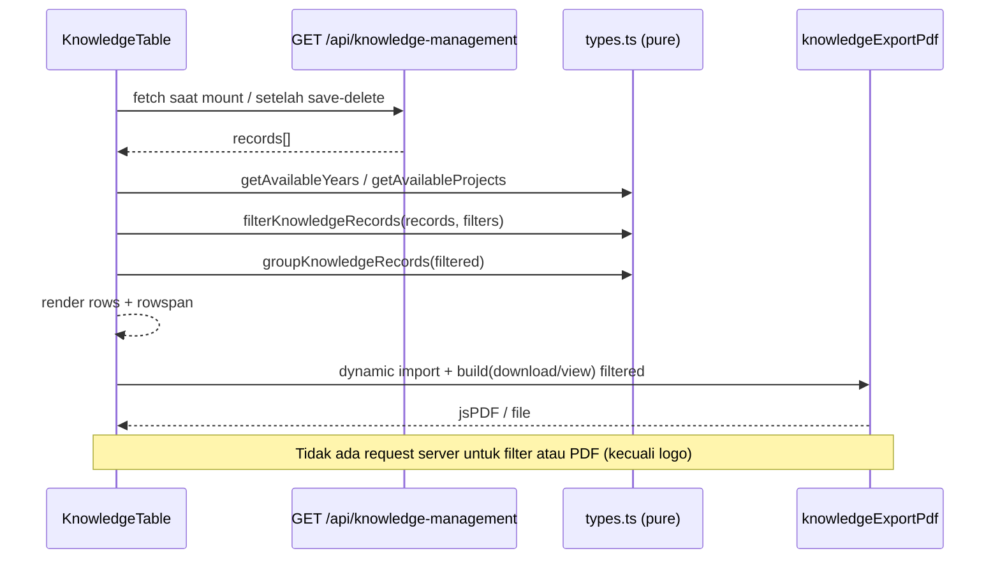

# KNOWLEDGE MANAGEMENT V2 — ENHANCEMENT TECHNICAL DESIGN (P3)

**Project:** BDWIKA / WIBEX
**Fase:** P3 — Technical Design (belum implementasi)
**Tanggal:** 5 November 2026
**Baseline:** `main` @ `303ca9b` (KM V2 final)
**Requirement:** `docs/design/KM_V2_ENHANCEMENT_REQUIREMENT.md` (449 baris, Owner decisions applied)
**Status:** DESIGN READY — menunggu review ChatGPT dan persetujuan Owner
**Source code / migration / database / test:** TIDAK diubah, TIDAK dijalankan

> Dokumen ini adalah desain teknis. Tidak ada source code, migration, database,
> test runtime, commit, push, atau deploy yang dijalankan pada P3.

---

## A. Executive Summary

Empat enhancement menambah **lapisan baca** pada KM V2: modal Lihat, dua varian
PDF, filter tahun, dan filter proyek. Tidak ada operasi tulis baru, tidak ada
endpoint baru, tidak ada migration, dan tidak ada perubahan model data.

| ID | Fitur | Ringkasan desain |
|---|---|---|
| F-01 | Modal Lihat | `KnowledgeViewDialog` (baru), data dari DTO yang sudah dimuat, tanpa request |
| F-02 | PDF | `knowledgeExportPdf.ts` (baru): F-02b tabel A4 landscape (primary) + F-02a record A4 portrait |
| F-03 | Filter tahun | `select` native, opsi dari record ter-muat, client-side, DESC |
| F-04 | Filter proyek | `KnowledgeProjectCombobox` (diekstrak), single-select, search nama+lokasi |
| D-KM-ENH-04 | Kolom Aksi | Selalu dirender; Edit kondisional, Lihat selalu |

**Dampak minimal:** 1 komponen modal, 1 modul PDF, 1 toolbar, 1 combobox
diekstrak, dan modifikasi terbatas `KnowledgeTable.tsx` + `types.ts`. API,
schema, migration, dan database **tidak berubah**.

### A.1 Keputusan desain utama

| ID | Keputusan desain | Alasan |
|---|---|---|
| OD-01 | Toolbar filter dan tombol PDF dirender oleh `KnowledgeTable` (action row), bukan `KnowledgeManagementPage` | Data record dimiliki `KnowledgeTable` (`:63-66`); memindahkannya ke Page berarti lift fetch/state dan mengubah Table jauh melebihi D-KM-ENH-04. Posisi visual tetap header konten |
| OD-02 | `KnowledgeTable` tetap pemilik fetch, filter state, dan dialog | Menghindari refactor komponen yang sudah PASS; satu sumber state |
| OD-03 | Fungsi filter murni di `types.ts` | Dapat diuji unit tanpa DOM dan dipakai ulang oleh PDF |
| OD-04 | Satu modul PDF dengan builder yang mengembalikan `jsPDF` | Dapat di-smoke-test; wrapper `download`/`view` mengikuti pola MSL |
| OD-05 | Combobox KM diekstrak, FormDialog hanya mengganti import | Menghindari duplikasi 200+ baris dan perilaku keyboard yang berbeda |

---

## B. Requirement Traceability Matrix

| Req | Kebutuhan | File impacted | Komponen | AC |
|---|---|---|---|---|
| F-01 | Modal Lihat read-only | `KnowledgeViewDialog.tsx` (A); `KnowledgeTable.tsx` (M) | Modal baru + tombol Lihat | AC-01…AC-08 |
| F-02b | PDF seluruh tabel | `knowledgeExportPdf.ts` (A); `KnowledgeTable.tsx` (M) | Menu PDF + builder tabel | AC-09…AC-16 |
| F-02a | PDF per-record | `knowledgeExportPdf.ts` (A); `KnowledgeViewDialog.tsx` (A) | Tombol di modal | AC-30…AC-37 |
| F-03 | Filter tahun | `types.ts` (M); `KnowledgeFilterToolbar.tsx` (A); `KnowledgeTable.tsx` (M) | `select` + `getAvailableYears` | AC-17…AC-23 |
| F-04 | Filter proyek | `KnowledgeProjectCombobox.tsx` (A); `KnowledgeFilterToolbar.tsx` (A); `KnowledgeTable.tsx` (M) | Combobox single-select | AC-24…AC-29a |
| D-KM-ENH-04 | Kolom Aksi selalu render | `KnowledgeTable.tsx` (M) | Header + sel aksi | AC-01, AC-08 |
| Regresi | KM V2 tetap utuh | `types.test.ts` (M); test baru (A) | — | 44/44 + test baru |

Tidak ada baris untuk API/schema/migration karena **tidak ada perubahan**.

---

## C. Repository Baseline

| Item | Nilai |
|---|---|
| Branch / HEAD | `main` @ `303ca9b` |
| Working tree | bersih + 2 dokumen untracked (`REQUIREMENT`, dokumen ini) |
| Test suite | 44 test / 16 suite PASS (baseline) |
| KM V2 | IMPLEMENTED BUT NOT FULLY VERIFIED — Admin PASS; HO/Management/Project BLOCKED |
| Database | `neondb` V2 fresh, 0 record KM |
| Migration | 16 entry, `0015` APPLIED |
| Runtime | dev server tidak dijalankan pada P3 |

---

## D. Existing vs Proposed Architecture

### D.1 Existing

```text
app/dashboard/knowledge-management/<slug>/page.tsx   (server, :13 role)
  └─ KnowledgeManagementPage                        (server, :42)
       └─ KnowledgeTable                            (client)
            ├─ fetch GET /api/knowledge-management   (:63-66)
            ├─ state records/loading/error/form      (:29-40)
            ├─ groups = groupKnowledgeRecords        (:108)
            ├─ KnowledgeFormDialog                   (Add/Edit)
            └─ KnowledgeDeleteDialog
```

### D.2 Proposed

```text
KnowledgeManagementPage (server, tidak berubah)
  └─ KnowledgeTable (client)
       ├─ fetch (tidak berubah)
       ├─ filters state (baru)
       ├─ KnowledgeFilterToolbar (baru, presentational)
       │    ├─ select Tahun
       │    └─ KnowledgeProjectCombobox (baru, diekstrak)
       ├─ PDF menu (baru) → dynamic import knowledgeExportPdf
       ├─ KnowledgeViewDialog (baru)
       ├─ KnowledgeFormDialog (import combobox diekstrak)
       └─ KnowledgeDeleteDialog
```

`KnowledgeManagementPage` tetap server dan tidak berubah; `currentUserRole`
sudah diteruskan ke Table (`:42`).

---

## E. Component Design

### E.1 `KnowledgeViewDialog.tsx` (baru)

**Props.**

```ts
type KnowledgeViewDialogProps = {
  record: KnowledgeRecordDto;
  knowledgeType: KnowledgeType;
  onClose: () => void;
  /** F-02a; tombol disembunyikan bila undefined (mis. sebelum F-02a selesai). */
  onDownloadPdf?: (record: KnowledgeRecordDto) => Promise<void>;
};
```

**State.** Hanya `pdfBusy: boolean` dan `pdfError: string | null` (untuk F-02a).
Tidak ada `loading` dan tidak ada fetch.

**Struktur render.**

```text
overlay (fixed inset-0 z-50, backdrop blur)
  panel role="dialog" aria-modal aria-labelledby
    header: badge kategori + judul "Lihat <label>" + tombol X
    body (scroll):
      Project card: nama, lokasi · tahun
      Kategori: badge read-only
      Content: <p class="whitespace-pre-wrap break-words">
      PIC: chips; non-aktif "(non-aktif)"
      Evidence: <a target="_blank" rel="noopener noreferrer">nama</a> + URL kecil
      Record History: grid 2 kolom Created/Updated (nama + formatKnowledgeDate)
    footer: Tutup | Download PDF (jika onDownloadPdf)
    error PDF (role="alert") bila gagal
```

**Behavior.** `Esc` menutup (kecuali `pdfBusy`), klik backdrop menutup, focus
trap Tab/Shift+Tab, fokus awal ke tombol Tutup, fokus kembali ke pemicu saat
unmount, `body.overflow` dikunci — pola `KnowledgeDeleteDialog.tsx:41-86`.
Mobile full-screen (`inset-0`, `rounded-none`), desktop `max-w-3xl`,
`max-h-[92dvh]`, body `overflow-y-auto`.

**Aksesibilitas.** `role="dialog"`, `aria-modal="true"`, `aria-labelledby`,
setiap bagian punya `<h3>`; content tidak dipotong; chip PIC dan tautan
evidence dapat dibaca screen reader.

**Jaringan.** Nol request. Data berasal dari `KnowledgeRecordDto` baris
(`types.ts:1-27`) yang sudah dimuat list API.

### E.2 `knowledgeExportPdf.ts` (baru)

**Export.**

```ts
export type KnowledgePdfFilters = {
  year: number | null;
  projectName: string | null;
};
export type KnowledgePdfMeta = { typeLabel: string };

export function knowledgeTablePdfFileName(meta, filters, now?): string;
export function knowledgeRecordPdfFileName(record, meta, now?): string;
export function buildKnowledgeTablePdf(records, meta, filters, now?, logo?): jsPDF;
export function buildKnowledgeRecordPdf(record, meta, now?, logo?): jsPDF;
export function downloadKnowledgeTablePdf(...): void;   // doc.save
export function viewKnowledgeTablePdf(...): void;      // blob + window.open
export async function loadWibexLogoDataUrl(): Promise<string | null>;
```

`build…` mengembalikan `jsPDF` (bukan `void`) agar dapat diuji smoke tanpa
menyentuh filesystem; `download…`/`view…` adalah wrapper tipis yang mengikuti
`mslExportPdf.ts:744-764`.

**F-02b — tabel (primary).** A4 landscape, margin 12 mm, `theme: "plain"`,
garis horizontal, header navy + aksen (token dari `mslExportPdf.ts:62-100`).
Kolom: No (10), Master Project (50), Content (90), PIC (45), Evidence (40),
History (38) = 273 mm printable. Header mencetak
`Tahun: <year|Semua> | Proyek: <nama|Semua>` dan "Tanggal export"; footer merek
+ `Halaman x / y`; `showHead: "everyPage"`, `rowPageBreak: "avoid"`.
Project **diulang per baris** (Q-02), bukan rowspan; PIC dipisah newline;
Evidence = nama + URL kecil.

**F-02a — record (menyusul).** A4 portrait, margin 14 mm, satu kolom:
project (nama, lokasi, tahun) → kategori → content (`splitTextToSize`,
pre-wrap) → PIC → evidence (nama + URL, `textWithLink` bila memungkinkan) →
history → footer halaman. Tidak ada tabel.

**Nama file.** Mengikuti AC-10/AC-33:
`Knowledge-<kategori>-<tahun|semua>-<timestamp>.pdf` dan
`Knowledge-<kategori>-<project-slug>-<id8>-<timestamp>.pdf`.
Slug: lowercase, non-alnum → `-`, maksimum 40 karakter, fallback `project`.
(Catatan: task P3 menyebut prefix `KM-`; AC yang sudah disetujui memakai
`Knowledge-`, jadi AC yang diikuti. Lihat O-06.)

**Logo.** `loadWibexLogoDataUrl` disalin lokal (duplikasi ke-4) — **tidak**
merefactor tiga exporter existing, sesuai requirement §3.1.

**Trigger.** Dynamic import di handler (`await import("./knowledgeExportPdf")`),
pola `MslEngineeringPage.tsx:471-473`; logo dimuat setelah import.

### E.3 `KnowledgeFilterToolbar.tsx` (baru)

**Props.**

```ts
type KnowledgeFilters = { year: number | null; projectId: string | null };

type Props = {
  years: number[];                       // DESC, dari records
  projects: KnowledgeProjectOptionDto[]; // unik, dari records
  filters: KnowledgeFilters;
  resultCount: number;
  totalCount: number;
  disabled?: boolean;
  onChange: (next: KnowledgeFilters) => void;
  onReset: () => void;
};
```

**Layout.** Kartu toolbar di atas header tabel: `Tahun` (`select` native,
"Semua tahun"), `Proyek` (`KnowledgeProjectCombobox`, "Semua proyek"), tombol
**Reset filter** (disabled bila tidak ada filter aktif), dan teks
`Menampilkan X dari Y record`. Mobile: stack vertikal; desktop: satu baris
`flex-wrap`.

**State.** Tidak ada; controlled dari `KnowledgeTable` (OD-02). Reset
mengosongkan `year` dan `projectId` sekaligus.

### E.4 `KnowledgeTable.tsx` (modifikasi)

| Perubahan | Detail |
|---|---|
| Filter state | `const [filters, setFilters] = useState<KnowledgeFilters>(EMPTY_KNOWLEDGE_FILTERS)` |
| Derived data | `filteredRecords = filterKnowledgeRecords(records, filters)`; `groups = groupKnowledgeRecords(filteredRecords)`; `years = getAvailableYears(records)`; `projects = getAvailableProjects(records)` |
| Toolbar | Render `<KnowledgeFilterToolbar …>` di atas header "Daftar …" |
| Tombol PDF | Menu `PDF` (View PDF / Download PDF) di action row, di samping **Tambah**; disabled saat loading/`filteredRecords.length === 0`/`pdfBusy` |
| Kolom Aksi | Header **selalu** dirender (hapus kondisi `canManage` di `:248-251`); sel aksi selalu dirender (`:342-355`) |
| Isi sel aksi | **Lihat** selalu; **Edit** hanya `canManage`; `whitespace-nowrap`, gap 2 |
| View state | `const [viewRecord, setViewRecord] = useState<KnowledgeRecordDto \| null>(null)`; render `KnowledgeViewDialog` |
| Ringkasan | `{filteredRecords.length} record pada {groups.length} Master Project` (`:133`) |
| Empty state | Jika `records.length > 0 && filteredRecords.length === 0`: "Tidak ada record untuk filter yang dipilih" + **Reset filter** |
| Nomor | `rowNumber` dihitung ulang dari `groups` terfilter (`:262-266`) |

Tidak ada perubahan pada fetch, retry, feedback, form, atau delete.

### E.5 `types.ts` (modifikasi)

```ts
export type KnowledgeFilters = { year: number | null; projectId: string | null };
export const EMPTY_KNOWLEDGE_FILTERS: KnowledgeFilters = { year: null, projectId: null };

export function filterKnowledgeRecords(
  records: KnowledgeRecordDto[],
  filters: KnowledgeFilters,
): KnowledgeRecordDto[];

export function getAvailableYears(records: KnowledgeRecordDto[]): number[];      // unik, DESC
export function getAvailableProjects(records: KnowledgeRecordDto[]): KnowledgeProjectOptionDto[]; // unik, nama ASC
```

Semua **pure**, tidak memutasi input, mempertahankan urutan server pada hasil
filter. `filterKnowledgeRecords` menerapkan AND: `year === null || record.project.year === year`
dan `projectId === null || record.project.project_id === projectId`.

### E.6 `KnowledgeProjectCombobox.tsx` (baru, ekstraksi)

```ts
type Props = {
  value: KnowledgeProjectOptionDto | null;
  onChange: (value: KnowledgeProjectOptionDto | null) => void;
  disabled?: boolean;
  autoFocus?: boolean;
  allowClear?: boolean;
  ariaLabel?: string;
  placeholder?: string;
  source:
    | { kind: "remote"; endpoint: string }        // FormDialog: project-options
    | { kind: "local"; options: KnowledgeProjectOptionDto[] }; // filter
};
```

Perilaku remote dipertahankan persis: debounce 250 ms (`KnowledgeFormDialog.tsx:170`),
AbortController + requestId, Arrow/Enter/Escape, role combobox/listbox
(`:263`, `:308`), limit notice (`:344`). Mode lokal: filter `name`/`location`
case-insensitive, tanpa fetch, tanpa debounce. `allowClear` menampilkan tombol X
(pola `EngineeringDatabaseProjectCombobox.tsx:212-232`).

`KnowledgeFormDialog` hanya mengganti fungsi privat `KnowledgeProjectCombobox`
dengan import komponen ini; props remote memakai endpoint yang sama.

---

## F. API Contract

| Aspek | Keputusan |
|---|---|
| Endpoint baru | **Tidak ada** |
| Query param baru | **Tidak ada** |
| Sumber data filter | `GET /api/knowledge-management?type=…` yang sudah dimuat (`route.ts:14-37`) |
| `project-options` | **Tidak dipakai filter**: Manage-only (`service.ts:410`) + `LIMIT 50` (`repository.ts:415,420`) |
| PDF | Dibangun di browser dari state; hanya logo yang di-fetch (`/asset/logo-top.png`) |
| Response shape | Tidak berubah; `data` tetap array `KnowledgeRecordDto` |

Konsekuensi: filter tidak dapat memilih proyek tanpa record (Q-05) dan tahun
tanpa record (D-KM-ENH-02) — konsisten dengan data yang tampil.

---

## G. UI/UX Design

### G.1 Wireframe konseptual

```text
┌ Halaman: Lesson Learn ─────────────────────────────────────────┐
│ [Core Enterprise] [Knowledge Management]                       │
│ Lesson Learn                                                   │
│ Kelola catatan …                                               │
│                                                                │
│ ┌ Kartu tabel ────────────────────────────────────────────────┐ │
│ │ Daftar Lesson Learn        [status] [PDF ▾] [+ Tambah]      │ │
│ │ 3 record pada 2 Master Project                              │ │
│ │ ┌ Toolbar ────────────────────────────────────────────────┐ │ │
│ │ │ Tahun [Semua ▾]  Proyek [Cari proyek… ▾]  [Reset]       │ │ │
│ │ │ Menampilkan 3 dari 7 record                             │ │ │
│ │ └─────────────────────────────────────────────────────────┘ │ │
│ │ No │ Project │ Content │ PIC │ Evidence │ History │ Aksi    │ │
│ │ 1  │ Tower A │ …       │ …   │ …        │ …       │ Lihat Edit│ │
│ └─────────────────────────────────────────────────────────────┘ │
└────────────────────────────────────────────────────────────────┘
```

### G.2 Perilaku filter

- Filter diterapkan **sebelum** grouping (H.3), rowspan dihitung ulang.
- Nomor urut mulai 1 pada hasil filter; ringkasan mengikuti hasil.
- Tahun dan proyek memakai **AND**; Reset mengosongkan keduanya.
- Tidak ada loading/round-trip; perubahan filter instan.
- Bila hasil kosong: empty state khusus + tombol Reset, bukan "Belum ada data".
- Bila data awal kosong: empty state existing dipertahankan.

### G.3 PDF menu

Tombol `PDF` dengan `aria-haspopup="menu"`, `aria-expanded`; item **View PDF**
dan **Download PDF**; `Esc`/klik luar menutup; disabled saat `pdfBusy`, loading,
atau hasil filter kosong. Error ditampilkan inline (`role="alert"`), bukan alert
browser. Pola: `MslEngineeringPage.tsx:510-599`.

### G.4 Modal Lihat

Satu modal, tanpa tab; body scroll; footer sticky. Di mobile menjadi
full-screen; tabel di belakang tidak di-scroll (`body` lock).

### G.5 Aksesibilitas

- Urutan fokus: PDF → Tambah → Tahun → Proyek → Reset → tabel → aksi baris.
- Combobox: `aria-expanded`, `aria-controls`, `aria-activedescendant`,
  `aria-autocomplete="list"`, label eksplisit.
- Tombol Lihat punya nama aksesibel unik, mis. `Lihat <project>`.
- Modal: focus trap, Escape, focus return, `aria-labelledby`.
- Status hasil filter diumumkan via `aria-live="polite"`.
- Tidak ada information conveyed by color alone (chip PIC memakai teks).

---

## H. Table Design Update

| Kolom | Perubahan |
|---|---|
| No | Dihitung ulang setelah filter |
| Master Project | Rowspan = jumlah record project **setelah** filter |
| Content | Tidak berubah (`whitespace-pre-wrap`) |
| PIC | Tidak berubah |
| Evidence | Tidak berubah |
| Record History | Tidak berubah |
| **Aksi** | **Selalu ada**; isi: Lihat (semua View) + Edit (Manage) |

Header Aksi tidak lagi kondisional (`KnowledgeTable.tsx:248-251`); sel aksi
tidak lagi kondisional (`:342-355`). `min-w-[1180px]` dipertahankan; dua tombol
muat dalam sel `whitespace-nowrap`.

---

## I. Data Flow



View modal memakai objek `record` yang sudah ada; tidak ada `GET /[id]`.

---

## J. Authentication & RBAC

| Aksi | Admin | Head Office | Management | Project | Penegak |
|---|---|---|---|---|---|
| Lihat modal | ✔ | ✔ | ✔ | ✔ | `canViewKnowledgeManagement` (`access.ts:10`) |
| Download PDF | ✔ | ✔ | ✔ | ✔ | idem |
| Filter tahun/proyek | ✔ | ✔ | ✔ | ✔ | idem |
| Edit | ✔ | ✔ | ✗ | ✗ | `canManageKnowledgeManagement` (`:14`) + server 403 |
| Hapus | ✔ | ✔ | ✗ | ✗ | tetap di form Edit |

Guard halaman tetap `layout.tsx:18`. Modal dan PDF read-only, sehingga tidak
menambah permukaan izin. Tiga role tetap **BLOCKED** untuk verifikasi runtime
(known limitation V2), bukan perubahan RBAC.

---

## K. Concurrency & Data Integrity

- Tidak ada write/transaction/optimistic locking pada empat fitur.
- Modal menampilkan `version` dari record yang dimuat; tidak ada pengecekan
  versi karena tidak ada mutasi.
- Jika record berubah di tab lain, tampilan tetap snapshot sampai refresh tabel;
  ini perilaku baca yang diterima (sama dengan tabel saat ini).
- PDF adalah representasi snapshot; tidak menjamin data real-time.
- Delete/Edit tetap memakai `expected_version` seperti V2 (`KnowledgeFormDialog`,
  `KnowledgeDeleteDialog`), tidak berubah.

---

## L. Regression Impact

| File | Dampak | Risiko | Mitigasi |
|---|---|---|---|
| `KnowledgeTable.tsx` | Filter, toolbar, PDF menu, view state, kolom Aksi | Sedang — komponen PASS | Unit test fungsi; manual Admin; diff review per blok |
| `KnowledgeFormDialog.tsx` | Ganti combobox privat dengan import | Rendah — perilaku identik | Manual Add/Edit; keyboard/limit notice |
| `types.ts` | Fungsi baru | Rendah — aditif | Unit test |
| `KnowledgeManagementPage.tsx` | **Tidak berubah** | Nol | — |
| API/schema/migration | **Tidak berubah** | Nol | — |
| MSL/Org/Program Kerja | **Tidak disentuh** | Nol | — |

Gate regresi: `npm test` 44/44 tetap PASS, `tsc`, `eslint`; manual Add/Edit/
Delete + filter + Lihat + PDF sebagai Admin.

---

## M. Testing Strategy

### M.1 Unit (node:test, `npm test`)

`types.test.ts` (tambahan):

- `filterKnowledgeRecords`: tahun saja, proyek saja, keduanya (AND), kosong,
  tidak memutasi input, mempertahankan urutan.
- `getAvailableYears`: unik, DESC, abaikan duplikat.
- `getAvailableProjects`: unik per `project_id`, urut nama ASC.
- Grouping setelah filter: `rowSpan` = jumlah record per project; project
  dengan 1 record → 1.

`knowledgeExportPdf.test.ts` (baru, smoke):

- `buildKnowledgeTablePdf` dengan 2 record → `jsPDF` terbuat, ≥ 1 halaman.
- `buildKnowledgeRecordPdf` dengan content 20.000 karakter → tidak throw.
- Nama file: sanitasi project, timestamp, tanpa karakter ilegal.
- Catatan: jsPDF di Node tidak merender pixel; test hanya memastikan tidak
  throw dan page count. **BELUM DIKETAHUI** apakah jsPDF 4.x memerlukan polyfill
  DOM di Node 24 — dibuktikan saat implementasi; bila gagal, test PDF di-skip
  dengan alasan tercatat (bukan dihapus).

### M.2 Runtime manual (Admin)

| Skenario | Ekspektasi |
|---|---|
| Buka modal Lihat | Semua field, content penuh, tanpa request |
| Filter tahun | Tabel, rowspan, nomor, ringkasan berubah |
| Filter proyek | Sama; pencarian nama/lokasi; keyboard |
| Kombinasi + reset | AND; reset penuh |
| PDF tabel | Hanya baris terfilter; header filter; halaman |
| PDF record | Satu record; A4 portrait; content utuh |
| Add/Edit/Delete | Tidak ada regresi |

Head Office/Management/Project: **BLOCKED** (tanpa kredensial) — tidak diklaim
teruji. Verifikasi read-only dilakukan lewat review kode + unit test, bukan
runtime.

### M.3 Regression

`npm test` (44 + baru), `npx tsc --noEmit`, `npx eslint` file berubah,
`git diff --check`.

---

## N. File Impact Inventory

| Aksi | File |
|---|---|
| **Add** | `src/components/dashboard/knowledge-management/KnowledgeViewDialog.tsx` |
| **Add** | `src/components/dashboard/knowledge-management/KnowledgeFilterToolbar.tsx` |
| **Add** | `src/components/dashboard/knowledge-management/KnowledgeProjectCombobox.tsx` |
| **Add** | `src/components/dashboard/knowledge-management/knowledgeExportPdf.ts` |
| **Add** | `src/components/dashboard/knowledge-management/knowledgeExportPdf.test.ts` |
| **Modify** | `KnowledgeTable.tsx` — filter/PDF/view/kolom Aksi |
| **Modify** | `types.ts` — `KnowledgeFilters` + 3 fungsi |
| **Modify** | `types.test.ts` — test filter |
| **Modify** | `KnowledgeFormDialog.tsx` — import combobox (perilaku sama) |
| **Tidak berubah** | `KnowledgeManagementPage.tsx`, tiga `page.tsx`, API, `schema.ts`, migration, database, MSL/Org |

---

## O. Technical Risks & Open Decisions

### O.1 Keputusan 6 open question

| ID | Keputusan | Alasan desain | Dampak bila diubah |
|---|---|---|---|
| Q-02 | **Rowspan PDF diulang per baris** (project name + lokasi/tahun di setiap baris) | Page break tidak memotong merged cell; PDF dapat dibaca/di-sort tanpa konteks hilang; rowspan tetap di UI | Perlu merge manual + risiko sel terpotong; ubah builder tabel |
| Q-05 | **Proyek tanpa record tidak dapat dipilih** | Opsi berasal dari record; konsisten D-03 (project tanpa knowledge tidak tampil); menghindari 403/limit 50 | Perlu endpoint View baru + daftar lengkap + empty state |
| Q-06 | **PDF mengikuti filter aktif** | Konsisten MSL/Program Kerja "yang tampil diekspor"; menghindari PDF raksasa | Ekspor seluruh data perlu tombol/parameter kedua |
| Q-07 | **PDF untuk semua role View** | Read-only, data sama dengan tabel; tidak menambah izin | Membatasi ke Manage akan menyembunyikan PDF dari 2 role |
| Q-08 | **Filter tidak di URL** | Tidak diminta; menghindari router/history + state hydration | Deep-link butuh query param + sinkronisasi |
| Q-10 | **Tidak ada filter kategori** | Kategori ditentukan submenu/halaman | Toolbar perlu state + query param `type` yang sudah ada |

### O.2 Risiko teknis

| ID | Risiko | Mitigasi |
|---|---|---|
| O-01 | PDF > 500 record lambat/blokir UI | Dynamic import; build sekali; tombol busy; `theme plain` tanpa hook per sel; ukur di P4; jika > 3 s, pertimbangkan konfirmasi jumlah (bukan pagination) |
| O-02 | Satu record 20.000 char melebihi tinggi halaman PDF tabel | `rowPageBreak: "avoid"` + autotable memecah sel bila perlu; tidak ada truncation; dicatat sebagai known behavior |
| O-03 | Logo gagal dimuat | try/catch → PDF tanpa logo (AC-15/AC-37) |
| O-04 | Filter + rowspan salah | Unit test grouping; rowspan dihitung dari group terfilter; manual |
| O-05 | Regresi kolom Aksi | Perubahan terlokalisasi; manual Admin; read-only tak teruji runtime (3 role BLOCKED) |
| O-06 | Nama file: task menyebut `KM-`, AC memakai `Knowledge-` | Ikuti AC yang disetujui; jika Owner ingin `KM-`, revisi AC-10/AC-33 lebih dulu |
| O-07 | jsPDF di Node untuk unit test | Smoke test; bila perlu polyfill, catat; jangan hapus test |
| O-08 | Toolbar di Table (OD-01) menyimpang dari rekomendasi requirement E.3 | Dijelaskan di OD-01; UX/posisi visual sama; tidak mengubah API/izin |

**Blocker:** tidak ada. OD-01 perlu diketahui reviewer, bukan open question bisnis.

---

## P. Implementation Plan

| Sub-fase | Isi | Gate |
|---|---|---|
| **A** | `types.ts`: tipe + 3 fungsi; unit test filter/grouping | `npm test` hijau |
| **B** | `KnowledgeFilterToolbar` + `KnowledgeProjectCombobox` + integrasi state di Table; kolom Aksi selalu render | tsc/eslint; manual filter; 44/44 |
| **C** | `KnowledgeViewDialog` + tombol Lihat + integrasi Table | manual modal + fokus; 44/44 |
| **D** | `knowledgeExportPdf.ts` + menu PDF tabel (F-02b) + tombol PDF record (F-02a) | manual PDF; smoke test; 44/44 |
| **E** | Regresi penuh, aksesibilitas, dokumentasi DL/feature register | `npm test`, `tsc`, `eslint`, `git diff --check` |

Urutan mengikuti requirement §7: **F-03+F-04 → F-01 (+D-KM-ENH-04) → F-02b →
F-02a**. Sub-fase B dan C dapat digabung bila Owner menghendaki satu rilis;
D harus setelah C untuk F-02a.

Tidak ada commit/push/deploy pada P3; implementasi menunggu "Siap dikembangkan".

---

## Q. Acceptance Criteria

| Fitur | AC | Verifikasi |
|---|---|---|
| F-01 | AC-01…AC-08 | Manual Admin + review kode role; unit tidak ada DOM |
| F-02b | AC-09…AC-16 | Manual PDF Admin + smoke test builder |
| F-02a | AC-30…AC-37 | Manual PDF dari modal + smoke test |
| F-03 | AC-17…AC-23 | Unit filter + manual |
| F-04 | AC-24…AC-29, AC-29a | Unit filter/opsi + manual keyboard |
| D-KM-ENH-04 | AC-01 (kolom Aksi), AC-08 (layout) | Manual Admin + code review; role View BLOCKED |
| Regresi | 44/44 + test baru | `npm test`, `tsc`, `eslint`, `git diff --check` |

**Definition of done P4:** seluruh AC di atas terpenuhi untuk Admin; tiga role
tetap tercatat BLOCKED; tidak ada perubahan API/schema/migration; 44 test lama
tetap PASS.

---

## Status

**READY FOR IMPLEMENTATION** — desain lengkap, 6 open question diputuskan
dengan alasan, tidak ada blocker teknis. Menunggu review ChatGPT dan persetujuan
Owner sebelum implementasi.
